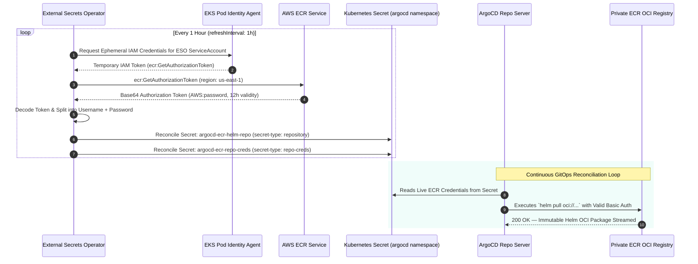

# External Secrets Operator & ECR Token Rotation

> Production-grade credential automation using the External Secrets Operator (ESO) and EKS Pod Identity to inject and refresh private AWS ECR authorization tokens into ArgoCD repository secrets.

---

## Architectural Problem & Root Cause

### The ArgoCD Helm OCI Authentication Defect
- The platform uses private Amazon ECR OCI registries (`${project}/${env}/${app}`) to host immutable Helm charts.
- AWS ECR authorization tokens generated via `aws ecr get-login-password` expire strictly after **12 hours**.
- Enabling ArgoCD repo-server's native credential helper (`reposerver.ecr.credential.helper = "true"`) fails consistently:
  The credential helper successfully authenticates internal Go library calls, but fails when ArgoCD forks external **Helm CLI subprocesses** (`helm pull oci://...`), resulting in `authentication required` and `401 Unauthorized` errors during sync cycles.

### The External Secrets Operator Solution
- Rather than running fragile cronjobs or granting `argocd-repo-server` cluster-admin rights, the platform deploys the **External Secrets Operator (ESO v2.12.0)**.
- ESO operates a native generator (`ECRAuthorizationToken`) backed by **EKS Pod Identity Associations**.
- ESO requests fresh ECR authorization credentials from AWS and writes standard Kubernetes secrets formatted for ArgoCD (`argocd.argoproj.io/secret-type: repository` and `repo-creds`).
- The secrets are automatically rotated every **1 hour** (`refreshInterval: 1h`), guaranteeing ArgoCD always holds valid credentials 11 hours before AWS expiration.

---

## Credential Rotation & Sync Sequence

The sequence diagram below traces how ESO automates token acquisition, rotation, and injection into ArgoCD:

---

## Custom Resource Architecture (`argocd-ecr-secret.yaml`)

The platform deploys three interdependent custom resources in the `argocd` namespace:

### 1. ECRAuthorizationToken Generator (`ecr-helm-token`)
- **API Version**: `generators.external-secrets.io/v1alpha1`
- **Responsibility**: Calls the AWS ECR control plane API using the node-level Pod Identity agent to request an authorization token for the configured region (`us-east-1`).
- **Emitted Keys**: `username` (`AWS`) and `password` (ephemeral 12-hour session secret).

### 2. Exact-Match Repository Secret (`argocd-ecr-helm-repo`)
- **API Version**: `external-secrets.io/v1`
- **Label**: `argocd.argoproj.io/secret-type: repository`
- **Target URL**: `${ecr_registry_url}/${project_name}/${environment}`
- **Properties**: Configured with `type: helm` and `enableOCI: "true"`, binding directly to the exact target OCI repository.

### 3. Wildcard Credential Template (`argocd-ecr-repo-creds`)
- **API Version**: `external-secrets.io/v1`
- **Label**: `argocd.argoproj.io/secret-type: repo-creds`
- **Target URL**: `${ecr_registry_url}`
- **Properties**: Serves as a wildcard credential provider for any repository under the account's ECR registry URL.

---

## Security & Operational Invariants

- **Least Privilege Enforcement**: The IAM policy bound to the ESO service account grants exclusively `ecr:GetAuthorizationToken` with resource `*`. No repository write, delete, or image modification permissions are granted.
- **Elimination of Repo-Server Permissions**: The `argocd-repo-server` service account requires zero IAM roles or AWS permissions. It consumes credentials solely from standard Kubernetes secret objects.
- **Fail-Safe Renewal Window**: By rotating tokens every 60 minutes (`refreshInterval: 1h`) against a 720-minute (12-hour) AWS token lifetime, the system tolerates up to 10 consecutive transient network or AWS API failures before ArgoCD experiences an expired token.
