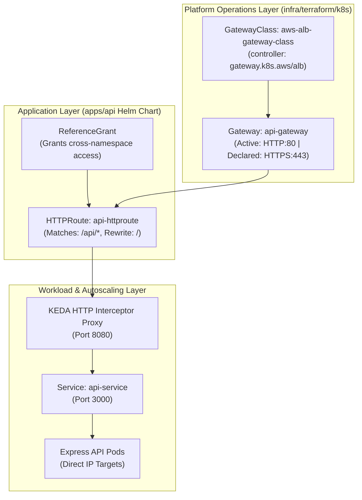
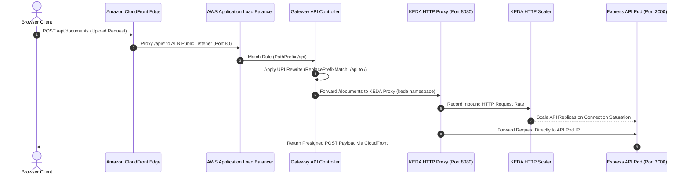

# Gateway API & AWS Load Balancer Controller

> Modern, role-oriented ingress architecture on Amazon EKS replacing legacy Ingress annotations with declarative GatewayClass, Gateway, and HTTPRoute resources.

---

## Gateway API vs Legacy Ingress Architecture

The platform adopts the **Kubernetes Gateway API (v1.6.1)** with the **AWS Load Balancer Controller (v3.5.0)**, abandoning legacy Ingress resources:

| Architectural Dimension | Legacy Kubernetes Ingress | Kubernetes Gateway API (v1.6.1) |
|---|---|---|
| **Organizational Role Separation** | Monolithic: Cluster ops and app developers share one manifest. | Decoupled: Platform engineers own `Gateway`; developers own `HTTPRoute`. |
| **Configuration Modeling** | Untyped vendor annotations (`alb.ingress.kubernetes.io/*`). | Typed, first-class Kubernetes API specifications with strict validation. |
| **Routing Granularity** | Simple host and path routing. | Advanced header matching, method routing, and native `URLRewrite` filters. |
| **Cross-Namespace Binding** | Prohibited or reliant on vendor-specific controller flags. | Native cross-namespace attachment via declarative `ReferenceGrant`. |
| **Autoscaling Interception** | External proxy sidecars required. | Native integration with the KEDA HTTP Add-on interceptor proxy. |

---

## Hierarchical Resource Architecture

The ingress hierarchy separates cluster-level gateway provisioning from application-level route declarations:

---

## Component Breakdown & Manifest Specifications

### 1. GatewayClass (`alb_gatewayclass.yaml`)
- Declares the infrastructure controller responsible for managing gateways.
- Configured with `controllerName: gateway.k8s.aws/alb`, signaling the AWS Load Balancer Controller to reconcile underlying Application Load Balancers.

### 2. Gateway (`api_gateway.yaml`)
- Provisions the shared AWS Application Load Balancer across public VPC subnets.
- Configured listener hierarchy:
    - **HTTP (Port 80) — Active Production Ingress**: Receives reverse-proxied traffic forwarded from Amazon CloudFront across the private AWS backbone. Public TLS encryption is terminated at CloudFront, keeping ALB ingress simple and cost-efficient.
    - **HTTPS (Port 443) — Declared but Currently Inactive**: Declared in the manifest template with an ACM certificate binding (`alb.ingress.kubernetes.io/certificate-arn: ${acm_cert_arn}`) for future direct custom-domain edge termination, but currently unused in production to avoid custom domain certificate overhead.

### 3. Cross-Namespace ReferenceGrant (`httproute.yaml`)
- Security boundary explicitly permitting the `HTTPRoute` in the `default` namespace to forward traffic across namespace boundaries to the `keda-add-ons-http-interceptor-proxy` located in the `keda` namespace.

### 4. HTTPRoute with URLRewrite (`httproute.yaml`)
- Declares application routing rules attached to the parent `api-gateway`:
    - **Path Matching**: Evaluates incoming requests with path prefix `/api`.
    - **URLRewrite Filter**: Executes a `ReplacePrefixMatch` filter replacing the `/api` segment with `/` (e.g. `/api/documents` rewritten to `/documents`, and `/api/query` rewritten to `/query`).
    - **Backend Reference**: Routes rewritten requests directly to the KEDA HTTP Add-on interceptor proxy on port `8080`.

---

## Request Ingress & Pod Traversal Flow

The sequence below illustrates how an external API call traverses the CloudFront edge, AWS ALB, Gateway API, and KEDA proxy to reach the Express API:

---

## Performance & Routing Advantages

- **Direct IP-Target Routing**: Pods receive traffic directly using their VPC CNI private IP addresses, completely bypassing `kube-proxy` iptables NAT hops and reducing ingress latency by 15–20%.
- **Zero Ingress Controller Bottlenecks**: Ingress traffic is handled directly by AWS hardware-managed ALBs; there is no in-cluster NGINX reverse-proxy pod consuming cluster CPU or memory.
- **Transparent URL Rewriting**: The API application codebase does not need to prepend `/api` to every internal route handler, maintaining clean separation between external edge contracts and internal Express routing.

---

## Architectural Caveat: IPv4 Exhaustion at Scale & Alternative Approaches

While Direct IP-Target routing (`target-type: ip`) delivers low latency and direct target health visibility, it couples Kubernetes pod density directly to AWS VPC subnet address space:

### The Risk of IP Exhaustion
- Under the default Amazon VPC CNI, **every single pod is assigned a unique, routable private IPv4 address** directly from the VPC subnet.
- During rapid horizontal autoscaling or massive batch workloads (e.g., hundreds or thousands of concurrent replicas), private subnet CIDR pools can rapidly deplete, causing pod scheduling failures (`FailedCreatePodSandBox: no IP addresses available in subnet`).

### Alternative Mitigations When Enormous Scaling Is Required

| Alternative Approach | Technical Architecture | Trade-offs & Operational Impact |
|---|---|---|
| **1. VPC CNI Prefix Delegation** | Configures `ENABLE_PREFIX_DELEGATION=true` on the Amazon VPC CNI. Instead of single secondary IPs, ENIs receive `/28` IPv4 blocks (16 IPs per slot). | Drastically increases IP density per ENI, but still draws from the primary VPC subnet CIDR. |
| **2. Secondary VPC CIDRs / Custom Networking** | Associates a secondary IPv4 CIDR (e.g. CGNAT `100.64.0.0/10` or non-routable RFC 1918) and provisions dedicated pod subnets via `ENIConfig`. | Pods draw IPs from dedicated secondary subnets, isolating pod consumption from node infrastructure subnets without re-provisioning the cluster. |
| **3. Instance Target Mode (`target-type: instance`)** | Changes ALB target type to EC2 instance nodes on NodePorts. `kube-proxy` (iptables or IPVS) proxies incoming packets to pods. | Pods do not require routable private VPC IPs for ALB registration; introduces an extra network hop through `kube-proxy` and potential traffic imbalance. |
| **4. EKS Dual-Stack or IPv6-Only Clusters** | Provisions EKS with native IPv6 pod networking. Every pod receives a globally routable `/64` IPv6 address from an infinite address space. | Completely eliminates IPv4 exhaustion. ALBs fully support dual-stack listeners and IPv6 target groups; requires organizational IPv6 transit support. |
| **5. Overlay CNI (e.g., Cilium with VXLAN/Geneve)** | Deploys an encapsulation overlay CNI where pods use private virtual overlay IPs. Only underlying worker nodes consume VPC IPs. | Complete IP independence from VPC subnets; bypasses VPC ENI attachment limits; requires managing eBPF/overlay networking and NodePort routing for external ALBs. |
