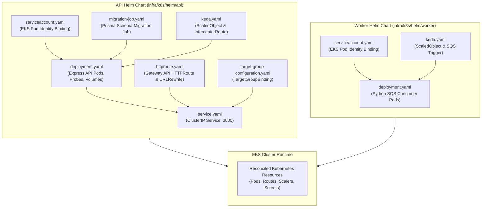
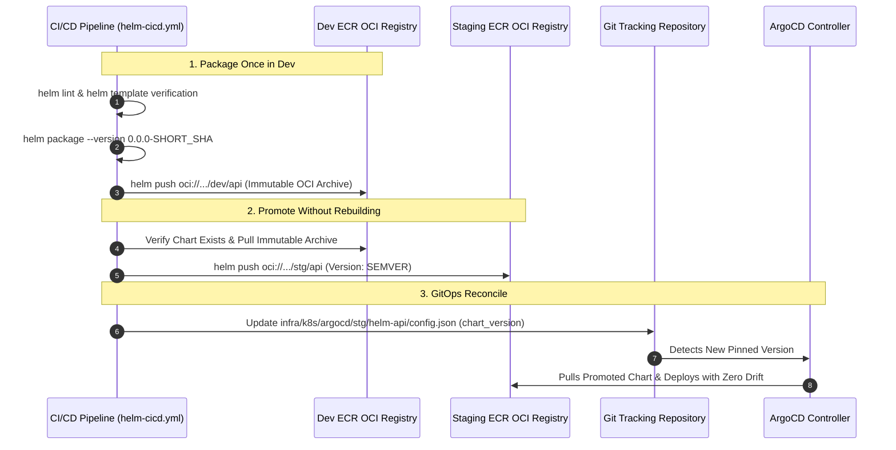

# Helm Chart Packaging & OCI Registries

> Declarative Helm packaging architecture for Express API and Python Worker microservices, integrating OCI packaging in private AWS ECR with decoupled GitOps environment overrides.

---

## Architectural Problem & Solution

### The Monolithic Chart Anti-Pattern
- In traditional setups, Helm charts embed environment-specific values files (`values.dev.yaml`, `values.prod.yaml`) inside the chart package.
- This creates tight coupling: changing a replica count requires releasing a new chart version, while releasing an application image requires mutating the chart repository.
- Deploying raw Kubernetes YAML manifests lacks parameterization, templating, and versioned rollback mechanisms.

### The Decoupled OCI Helm Architecture
- The platform maintains two focused microservice charts: `infra/k8s/helm/api` and `infra/k8s/helm/worker`.
- **Chart Immutability**: Charts are packaged strictly once per commit on `dev` and pushed to private **AWS ECR OCI registries** (`oci://${ecr_registry_url}/${project}/${env}/${app}`).
- **Slash-Delimited Namespaces**: The chart names (`name: api` and `name: worker` in `Chart.yaml`) match the trailing segment of the ECR repository, allowing native `helm push` without modifying files on disk.
- **Environment Decoupling**: Environment-specific overrides live in ArgoCD Git tracking directories (`infra/k8s/argocd/${env}/${app}/values.yaml`), keeping chart packages 100% environment-agnostic.

---

## Helm Manifest & Runtime Architecture

The diagram below maps the templates in each Helm chart to the runtime objects instantiated in the EKS cluster:

---

## Template Inventory & Specifications

### 1. Express API Chart (`infra/k8s/helm/api`)
- **`deployment.yaml`**:
    - Pod template specifying Node.js 24 Alpine container image.
    - Security context running as non-root user (`runAsUser: 1001`, `readOnlyRootFilesystem: true`).
    - Liveness and readiness probes pointing to `GET /health` on port 3000 with 10s initial delay.
    - Ephemeral CSI volume mount attaching the AWS `SecretProviderClass` at `/mnt/secrets`.
- **`service.yaml`**:
    - `ClusterIP` service exposing port 3000 to internal cluster routing.
- **`httproute.yaml`**:
    - Gateway API route attaching to the shared `api-gateway`.
    - Implements `URLRewrite` (`ReplacePrefixMatch: /`) and cross-namespace `ReferenceGrant` to forward traffic to the KEDA proxy on port 8080.
- **`migration-job.yaml`**:
    - Kubernetes pre-deploy hook job executing `npx prisma migrate deploy` before application pods roll out, ensuring zero-downtime database schema updates.
- **`keda.yaml`**:
    - Declares `InterceptorRoute` and `ScaledObject` (`type: external-push`) for request-rate autoscaling.
- **`serviceaccount.yaml`**:
    - Workload identity service account annotated for EKS Pod Identity Associations.

### 2. Python Worker Chart (`infra/k8s/helm/worker`)
- **`deployment.yaml`**:
    - Pod template for the Python 3.11 consumer daemon.
    - Security context running as non-root user (`runAsUser: 1001`).
    - Configured with `terminationGracePeriodSeconds: 60` to allow in-flight SQS batches to reach their checkpoint before pod eviction.
    - Ephemeral CSI volume mount attaching AWS secrets.
- **`keda.yaml`**:
    - Declares `ScaledObject` and `TriggerAuthentication` scaling the worker deployment from 0 to 10 pods based on Amazon SQS queue depth.
- **`serviceaccount.yaml`**:
    - Dedicated service account binding worker pods to the worker IAM role for Bedrock, S3, SQS, and RDS IAM authentication.

---

## Private OCI Packaging & GitOps Promotion

The packaging and promotion lifecycle follows a strict pipeline:

---

## Clean Packaging Safeguards (`.helmignore`)

Both charts enforce clean OCI packaging via `.helmignore`:

- Prevents local configuration files (`.env`, `values.*.yaml`), `.git` directories, and system artifacts from leaking into public or private OCI archives.
- Guarantees that the packaged Helm archive contains exclusively pure template definitions, with all environment configurations injected externally via ArgoCD.
