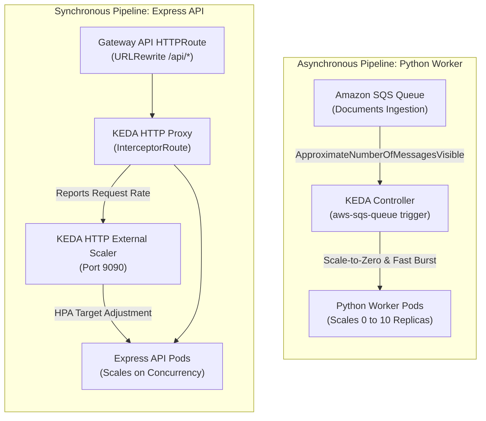
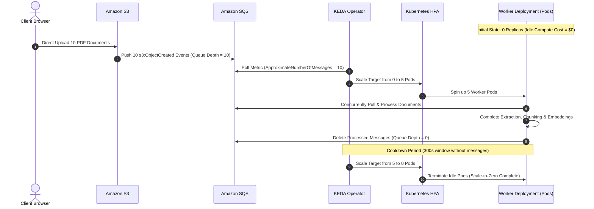
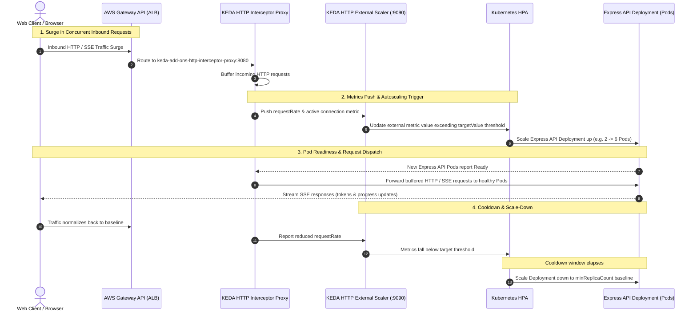

# Event-Driven Autoscaling with KEDA

> Production autoscaling architecture leveraging KEDA v2.20.2 to drive scale-to-zero compute savings on asynchronous workers while maintaining responsive API throughput under traffic surges.

---

## Architectural Problem & Autoscaling Strategy

### Standard HPA Limitations
- **Metric Latency**: Standard Kubernetes Horizontal Pod Autoscalers (HPA) scale based on CPU or memory thresholds. By the time a compute-intensive PDF batch spikes CPU, worker queues have already backlogged.
- **Inability to Scale to Zero**: Standard HPAs enforce a minimum replica count of 1. Idle worker pods continuously consume cluster compute and memory even when zero documents are pending ingestion.
- **HTTP Burst Blindness**: CPU metrics poorly correlate with concurrent HTTP SSE streams, which are I/O-bound rather than compute-bound.

### KEDA Dual-Workload Autoscaling Solution
The platform deploys **KEDA (v2.20.2)** with tailored scalers decoupled by workload traffic patterns:

---

## 1. Python Worker: SQS Queue Depth Autoscaling (0 to 10)

### Trigger Specification (`infra/k8s/helm/worker/templates/keda.yaml`)
- **Trigger Type**: `aws-sqs-queue`
- **Target Workload**: `worker-deployment`
- **Metric**: Evaluates AWS CloudWatch / SQS metric `ApproximateNumberOfMessagesVisible`.
- **Target Value (`queueLength`)**: Configured target threshold (e.g. 2 messages per pod). When 8 messages arrive, KEDA scales the deployment to 4 pods.
- **Replica Bounds**: `minReplicaCount: 0`, `maxReplicaCount: 10`.
- **Timing Parameters**:
  - `pollingInterval: 15s` (Evaluates queue depth every 15 seconds).
  - `cooldownPeriod: 300s` (5-minute stabilization window before scaling to zero, preventing flapping).

### Zero-Credential Pod Identity Authentication
- The worker `ScaledObject` references a native `TriggerAuthentication` custom resource (`keda-auth-aws`).
- Uses `podIdentity.provider: aws` with the worker's EKS IAM role ARN.
- KEDA leverages the node-level EKS Pod Identity agent to poll SQS metrics without static AWS access keys.

### SQS Autoscaling Lifecycle Sequence

---

## 2. Express API: KEDA HTTP Add-on Autoscaling

### Trigger Specification (`infra/k8s/helm/api/templates/keda.yaml`)
- **Controller**: KEDA HTTP Add-on (`keda-add-ons-http-external-scaler.keda.svc:9090`).
- **Trigger Type**: `external-push`
- **Target Workload**: `api-deployment`
- **Routing Manifest (`InterceptorRoute`)**:
  - Captures incoming traffic routed from Gateway API `HTTPRoute` to `keda-add-ons-http-interceptor-proxy:8080`.
  - Measures request rates and pending HTTP connection pools.
  - Dynamically triggers HPA scaling adjustments as active streaming sessions (SSE progress streams and Bedrock LLM responses) accumulate.

### HTTP Autoscaling Lifecycle Sequence

---

## Cost & Operational Benefits

- **65% Compute Savings**: Workers scale to zero overnight and during periods of inactivity. Compute charges for ingestion workers accrue strictly when documents are actively being parsed.
- **Graceful Termination Protection**: Worker pods trap `SIGTERM` signals and cooperative shutdown flags. In-flight jobs are allowed to complete their batch checkpoints before pod termination during scale-down operations.
- **No Cold-Start Ingress Penalty**: While workers scale 0 to 10 asynchronously, the Express API maintains a hot minimum baseline to guarantee instant sub-millisecond edge response times for initial page loads.
