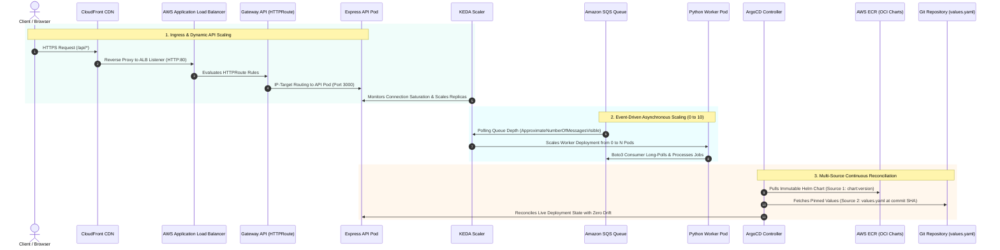

# Kubernetes Platform & GitOps Architecture

> Enterprise Kubernetes platform architecture on Amazon EKS Auto Mode, orchestrating declarative GitOps reconciliation, modern Gateway API ingress, automated credential rotation, and dual event-driven autoscaling.

---

## Architectural Role & Principles

The Kubernetes platform layer (`infra/terraform/k8s`) transforms the raw Amazon EKS cluster into an enterprise-grade cloud-native application hosting platform, enforcing:

- **EKS Auto Mode (Kubernetes 1.37)**: Operates with AWS-managed `general-purpose` and `system` node pools. Traditional EC2 launch templates, manual node group patching, and custom Karpenter CRD configurations are replaced by AWS-managed automated node scaling, OS patching, and built-in EBS CSI integration.
- **Modern Gateway API Ingress (v1.6.1)**: Replaces legacy Ingress with declarative `GatewayClass`, `Gateway`, and `HTTPRoute` resources managed natively by the **AWS Load Balancer Controller (v3.5.0)** with direct VPC CNI IP-target routing.
- **Multi-Source ArgoCD GitOps Engine**: Reconciles microservices using ArgoCD's Multiple Sources pattern (`$ref`), which pulls from two decoupled upstream sources simultaneously:
  - **Source 1 (Packaging)**: An immutable, versioned Helm OCI chart hosted in an OCI registry (AWS ECR: `{{chart_name}}:{{chart_version}}`).
  - **Source 2 (Configuration)**: The environment-specific `values.yaml` in Git (`$app_values/infra/k8s/argocd/${environment}/{{app}}/values.yaml`), pinned to an exact commit SHA (`{{target_commit}}`).
  - **Matrix Generator Join**: Dynamically links application image releases (tracked on `{env}/app`) and Helm chart releases (tracked on `{env}/helm`), allowing templates and application parameters to evolve and release completely independently.
- **Automated Credential Rotation**: Deploys the **External Secrets Operator (ESO)** with EKS Pod Identity to generate 12-hour AWS ECR authorization tokens, rotating them every 1 hour into ArgoCD repository secrets to solve private Helm OCI authentication.
- **Dual Workload Autoscaling**: Implements **KEDA (v2.20.2)** to autoscale workloads based on real workload pressure: scaling Python Worker pods 0→10 on Amazon SQS queue depth, and Express API pods on HTTP connection saturation via the KEDA HTTP Add-on.

---

## Platform Architecture Topology

The pre-rendered diagram below illustrates the platform controllers, custom resource definitions (CRDs), and operational reconciliation loops running on Amazon EKS:

  

    
  

---

## Platform Component Matrix

| Component                        | Version | Architectural Responsibility                                                                                 |
| -------------------------------- | ------- | ------------------------------------------------------------------------------------------------------------ |
| **Amazon EKS (Auto Mode)**       | 1.37    | Managed control plane and automated node provisioning (`general-purpose` and `system` pools).                |
| **AWS Load Balancer Controller** | 3.5.0   | Reconciles Gateway API resources into an AWS Application Load Balancer with IP-target pod routing.           |
| **Kubernetes Gateway API**       | 1.6.1   | Declarative ingress hierarchy: `GatewayClass` (`alb`), `Gateway` (`api-gateway`), and workload `HTTPRoute`.  |
| **ArgoCD (ApplicationSet)**      | 10.3.0  | Multi-source continuous delivery reconciling Helm OCI packages with Git tracking repository values.          |
| **External Secrets Operator**    | 2.12.0  | Assumes EKS Pod Identity to generate 12-hour AWS ECR tokens and rotates them hourly into ArgoCD secrets.     |
| **KEDA Core Scaler**             | 2.20.2  | Event-driven autoscaling scaling Python Worker pods 0→10 based on SQS `ApproximateNumberOfMessagesVisible`.  |
| **KEDA HTTP Add-on**             | v1beta1 | Request-rate pod autoscaling for Express API pods via `InterceptorRoute` and external push scalers.          |
| **Secrets Store CSI Driver**     | 1.4.0   | Mounts sensitive parameters from Secrets Manager and SSM directly into pod memory via ephemeral CSI volumes. |

---

## Inbound Ingress & Platform Control Plane Flow

The sequence below illustrates how incoming traffic and continuous delivery reconciliation interact across cluster boundaries:

---

## Detailed Platform Guides

Deep-dive operational specifications and manifest configurations are detailed in the following sub-pages:

- [Secrets Store CSI Driver](secrets-csi-driver.md): In-pod secret injection without etcd persistence.
- [Gateway API & AWS LB Controller](gateway-api-alb.md): Modern ingress routing, GatewayClasses, and HTTPRoutes.
- [ArgoCD Multi-Source GitOps](argocd-gitops.md): Dual-source ApplicationSets and commit SHA pinning.
- [External Secrets Operator](external-secrets.md): Automated ECR token rotation for ArgoCD Helm OCI pulls.
- [Event-Driven Autoscaling (KEDA)](keda-autoscaling.md): SQS queue depth and HTTP request-rate scaling mechanics.
- [Helm Chart Packaging](helm-charts.md): Modular chart definitions, templates, and OCI publishing.
