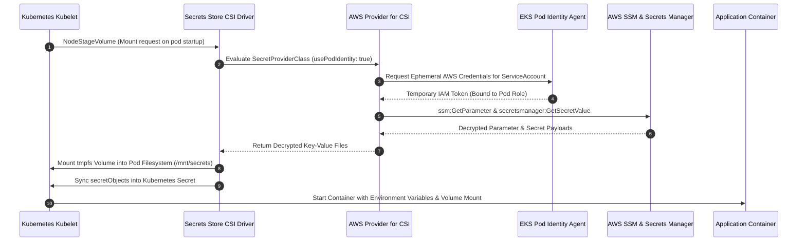

# Secrets Store CSI Driver Integration

> Zero-credential secret injection mechanism mounting sensitive configuration directly from AWS Systems Manager Parameter Store and Secrets Manager into pod volumes via EKS Pod Identity.

---

## Architectural Problem & Solution

### The Security Challenge
- Traditional Kubernetes configurations inject sensitive data (database credentials, HMAC encryption keys, API tokens) via static Kubernetes `Secret` objects.
- Static secrets stored in `etcd` are vulnerable to cluster-wide inspection, base64 exposure in version control, and lack automated rotation.
- Embedding AWS API keys inside pods to fetch secrets violates least-privilege standards.

### The CSI In-Memory Solution
- The CSI driver and AWS provider are deployed directly as an EKS managed cluster add-on (`aws-secrets-store-csi-driver-provider`) in the EKS Terraform module (`modules/eks`), pre-configured with a 120-second rotation poll interval (`rotationPollInterval: 120s`).
- Workload pods attach an **ephemeral CSI volume** backed by the `secrets-store.csi.k8s.io` driver.
- The driver intercepts pod creation, queries the declarative `SecretProviderClass`, and fetches values from AWS SSM Parameter Store and Secrets Manager.
- The driver assumes the pod's **EKS Pod Identity IAM role** (`usePodIdentity: "true"`), completely eliminating static AWS access keys.
- Secret values are mounted as an in-memory tmpfs volume at `/mnt/secrets` and synchronized into Kubernetes secret objects (`syncSecret.enabled: true`) for container environment variable binding.

---

## Secret Injection & Mount Lifecycle

The sequence diagram below traces how credentials traverse from AWS systems into running pod memory:

---

## SecretProviderClass Specification

The platform configures a unified `SecretProviderClass` (`${project_name}-${environment}-secrets-class`) managing two discrete parameter sets:

### 1. Application Infrastructure Parameters
- **Source**: AWS SSM Parameter Store (`${project_name}/${environment}/config`).
- **Managed Parameters**:
  - `DB_IAM_AUTH_ENABLED`, `DB_HOST`, `DB_PORT`, `DB_NAME`, `DB_USER`, `DB_SSL`.
  - `S3_BUCKET` (Documents bucket identifier).
  - `CORS_ALLOWED_ORIGIN` (Whitelisted domain for cross-origin credentials).
  - `EMBEDDING_PROVIDER`, `EMBEDDING_MODEL`, `EMBEDDING_ENDPOINT`.
  - `LLM_PROVIDER`, `LLM_MODEL`, `LLM_ENDPOINT`, `LLM_MAX_TOKENS`.
  - `QUEUE_URL`, `DLQ_URL`.

### 2. Cryptographic & Sensitive Secrets
- **Source**: AWS SSM Parameter Store Encrypted SecureString / Secrets Manager.
- **Managed Parameters**:
  - `SESSION_SECRET`: 256-bit cryptographic key used for HMAC session cookie signing.
  - `LLM_API_KEY`: API credentials for external model endpoints when operating in hybrid cloud mode.
  - `EMBEDDING_API_KEY`: Credentials for external embedding inference.

---

## Pod Identity Authorization

To authorize the CSI driver on behalf of scheduled pods, the EKS cluster IAM policies grant targeted permissions strictly scoped to the environment prefix:

- `ssm:GetParameter` and `ssm:GetParameters`: Allowed on `arn:aws:ssm:*:*:parameter/${project_name}/${environment}/*`.
- `secretsmanager:GetSecretValue` and `secretsmanager:DescribeSecret`: Allowed on `arn:aws:secretsmanager:*:*:secret:${project_name}/${environment}/*`.
- `kms:Decrypt`: Allowed on the AWS KMS customer-managed key encrypting the parameters.

---

## Volume Lifecycle & Production Invariants

- **Ephemeral Storage Only**: Secrets are mounted into RAM-backed `emptyDir` filesystems. They are never written to worker node persistent disks.
- **Pod Lifecycle Coupling**: When an API or Worker pod terminates, the mounted CSI volume is unmounted and memory is immediately reclaimed.
- **Fail-Fast Startup**: If AWS SSM or Secrets Manager is unreachable or IAM permissions are rejected, the CSI driver fails the `NodePublishVolume` phase, keeping the pod in `ContainerCreating` status and preventing execution with missing credentials.
- **Zero Raw Secrets in Git**: Helm templates reference only the abstract `SecretProviderClass` name, ensuring GitOps repositories contain zero base64 or plaintext credentials.
