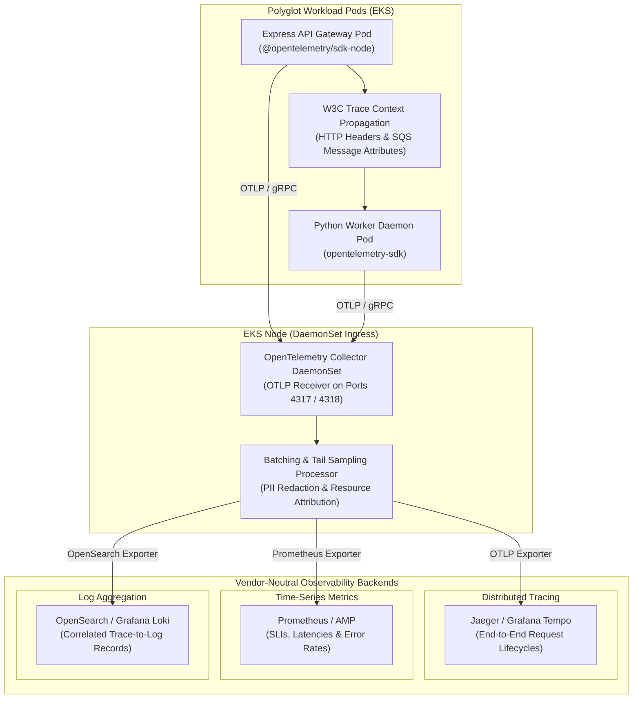

# 🚧 Planned: OpenTelemetry Observability Strategy

> Comprehensive architectural roadmap for migrating platform telemetry to an OpenTelemetry-native, vendor-neutral observability standard across polyglot microservices.

---

## Architectural Rationale & Motivation

The current platform relies on standalone application logs emitted to `stdout` and basic Kubernetes container health probes. To achieve enterprise-grade observability without cloud vendor lock-in, the target architecture introduces an **OpenTelemetry (OTel)** telemetry pipeline based on the following architectural drivers:

- **Strict Vendor Neutrality**: Avoids coupling application source code to proprietary monitoring SDKs (such as AWS X-Ray SDKs or proprietary CloudWatch agent protocols). OpenTelemetry establishes an open, portable industry standard.
- **Polyglot Context Propagation**: Seamlessly correlates asynchronous distributed workflows across runtime boundaries (Node.js/TypeScript API and Python 3.11 Worker) using standard W3C Trace Context (`traceparent`).
- **Decoupled Telemetry Routing**: Telemetry generation is separated from telemetry storage. Applications emit data via OpenTelemetry Protocol (OTLP) to a local collector, which routes data to any backend without requiring application recompilation.
- **Unified Telemetry Signals**: Unifies distributed traces, operational metrics, and structured logs into a correlated telemetry graph sharing common identifiers (`trace_id`, `span_id`, and `tenant_id`).

---

## Target OpenTelemetry Architecture

The diagram below illustrates the planned deployment model featuring in-pod OpenTelemetry instrumentation, node-level collection via an EKS DaemonSet, and flexible export to vendor-neutral observability backends:

---

## Planned Telemetry Pillars

### 1. Distributed Tracing & Asynchronous Correlation
- **End-to-End Spans**: Traces an entire request lifecycle: browser upload dispatch, S3 presigned POST completion, S3 event delivery, SQS queue latency, worker text extraction, chunking, Bedrock Titan embedding generation, and vector insertion.
- **Asynchronous SQS Context Propagation**: Injects W3C trace headers into Amazon SQS message attributes upon upload confirmation. The worker extracts the parent context upon message consumption, linking asynchronous batch ingestion to the initiating user session.
- **RAG Generation Spans**: Dedicated spans tracking Bedrock Claude 3.5 Sonnet prompt assembly, streaming token latencies, and deterministic citation validation.

### 2. Operational & Business Metrics
- **Ingestion Pipeline Performance**: Histograms measuring PyMuPDF extraction duration, sliding-window chunking speed, and vector batch upsert commit latencies.
- **LLM Performance & Cost Metrics**: Tracks time-to-first-token (TTFT), tokens-per-second streaming throughput, and prompt/completion token consumption counters.
- **Bedrock Throttling Counters**: Tracks `ThrottlingException` events to dynamically evaluate exponential backoff thresholds and quota headroom.
- **Queue Health Metrics**: Complements AWS CloudWatch SQS metrics with in-pod queue consumer wait-time histograms.

### 3. Correlated Contextual Logging
- **Trace-to-Log Correlation**: Automatic injection of active `trace_id` and `span_id` into Winston (API) and Python `logging` JSON records.
- **Zero-Effort Pivoting**: Enables operators to transition from a latency spike in a Grafana or Prometheus dashboard directly to the exact error log line in OpenSearch with a single click.

---

## Technical Comparison: Current vs Target Architecture

| Capability | Current Baseline | Target OpenTelemetry Architecture |
| :--- | :--- | :--- |
| **Distributed Tracing** | None (Isolated request duration logging) | W3C distributed traces spanning API, SQS, Worker, and Bedrock |
| **Correlation Model** | Custom `sessionId` string matching in logs | Standardized `trace_id` and `span_id` shared across all signals |
| **Telemetry Transport** | Direct container `stdout` | In-memory OTLP/gRPC delivery to local node collector |
| **Autoscaling Metrics** | KEDA pulling SQS queue depth via AWS API | Prometheus/OTel custom metric exporter integrated with KEDA |
| **Vendor Dependency** | Passive dependency on AWS CloudWatch | 100% vendor-neutral; exportable to any cloud or self-hosted backend |
| **Code Coupling** | Runtime-specific Winston and Python loggers | Standardized OpenTelemetry API with decoupled SDK configuration |

---

## Phased Implementation Roadmap

1. **Phase A: Collector Infrastructure Deployment**:
    - Deploy the OpenTelemetry Collector as an EKS DaemonSet using the official Helm chart.
    - Configure OTLP gRPC/HTTP receivers, resource processors, and exporter credentials for target backends.

2. **Phase B: Service Auto-Instrumentation**:
    - Enable `@opentelemetry/sdk-node` in the Express API gateway to instrument HTTP routes and PostgreSQL database calls automatically.
    - Enable `opentelemetry-sdk` in the Python worker to trace PyMuPDF extraction and SQLAlchemy database transactions.

3. **Phase C: SQS Context Propagation & Custom Spans**:
    - Implement W3C trace header injection in S3 event notification handlers and SQS message attributes.
    - Instrument manual custom spans around Amazon Bedrock Titan embedding calls and Claude streaming loops.

4. **Phase D: Dashboard & Alerting Integration**:
    - Provision Grafana dashboards visualizing RAG request rates, p95/p99 token latencies, worker queue dwell times, and error rates.
