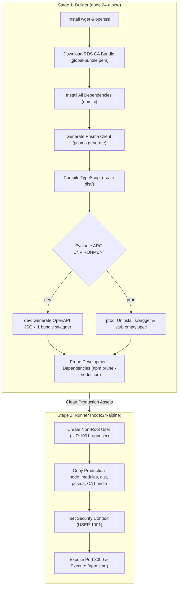

# API Docker Build & Packaging

> Two-stage multi-stage containerization, non-root user execution, and dual dev/prod container compilation via GitHub Actions.

---

## Two-Stage Build Pipeline

The API container is compiled using a multi-stage Dockerfile (`apps/api/Dockerfile`) based on **Node.js 24 Alpine**, isolating the TypeScript compilation toolchain from the minimal production runtime.

---

## Dual Variant Matrix Strategy

The continuous integration pipeline (`.github/workflows/api-worker-cicd.yml`) builds two distinct image variants in parallel for development and higher environments:

| Variant Name | Build Argument | ECR Image Tag | Target Environment | Swagger UI Included |
|:---|:---|:---|:---|:---|
| **Full Image** | `ENVIRONMENT=dev` | `${SHORT_SHA}` | `dev` | Yes (`/api-docs` active) |
| **Slim Image** | `ENVIRONMENT=prod` | `${SHORT_SHA}-slim` | `stg` and `prod` | No (`swagger-ui-express` purged) |

---

## Security & Runtime Hardening

- **Non-Root Execution**: Runs strictly as numeric UID `1001` (`appuser`), preventing container breakout privileges.
- **Minimal Surface**: Development dependencies (`typescript`, `@types/*`, build linters) are stripped prior to stage copy via `npm prune --production`.
- **SSL Truststore**: Bundles the official Amazon RDS global certificate bundle (`global-bundle.pem`) to enforce TLS certificate verification on all database queries.
- **Strict Immutability**: Production never compiles containers. The tested `slim` variant created during the development build is verified and promoted across environments.
