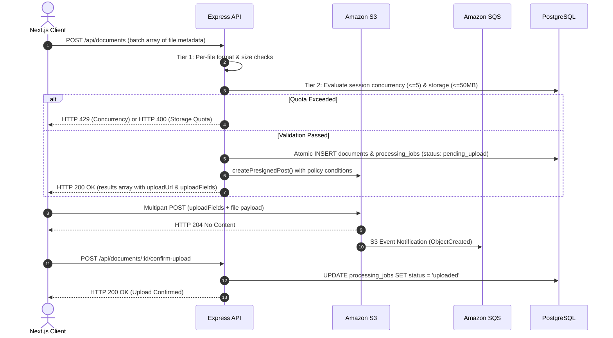

# Document Upload & Ingestion Ingress

> Secure multi-file upload orchestration, storage-layer policy enforcement, concurrency controls, and idempotent state transitions.

---

## Batch Upload Architecture

The document upload pipeline avoids funneling binary file payloads through the Express API. Instead, the API acts as a policy gatekeeper that validates session quotas, reserves tracking records, and issues Amazon S3 **Presigned POST** descriptors for direct browser-to-storage transfer.

---

## Two-Tier Validation Model

Requests submitted to `POST /api/documents` undergo strict two-phase validation:

### Tier 1: Per-File Independent Validation
Each file entry in the payload array is evaluated independently. Files failing checks are marked as `rejected` in the response array with specific error codes, while valid files proceed to Tier 2:

- **MIME Allowlist**: Accepts strictly `application/pdf` and `text/plain`.
- **File Size Range**: Each individual file must be between 1 byte and 5 MB (5,242,880 bytes).

### Tier 2: Batch-Level Atomic Validation
The subset of files that pass Tier 1 is evaluated atomically against the active tenant session state. If either condition fails, the entire batch is rejected with zero database rows created:

| Boundary | Enforcement Limit | HTTP Rejection |
|:---|:---|:---|
| **Concurrency Ceiling** | Max **5 active documents** in flight (`pending_upload`, `uploaded`, `downloading`, `validating`, `extracting`, `chunking`, `embedding`). | `HTTP 429 Too Many Requests` (`concurrency_limit_exceeded`) |
| **Cumulative Storage Quota** | Max **50 MB (52,428,800 bytes)** cumulative storage across active documents per session. | `HTTP 400 Bad Request` (`storage_quota_exceeded`) |

---

## Presigned POST Policy Enforcement

Unlike standard presigned PUT URLs, `@aws-sdk/s3-presigned-post` enables cryptographic policy conditions enforced directly by Amazon S3:

- **Size Boundary**: `content-length-range: [1, 5242880]` rejects uploads outside 1B–5MB at the S3 bucket boundary.
- **Type Locking**: `Content-Type` matching rejects mismatched MIME uploads prior to storage.

---

## Confirm-Upload State Machine & Idempotency

When S3 completes writing the file, the browser invokes `POST /api/documents/:id/confirm-upload` to transition the status from `pending_upload` to `uploaded`.

- **Race Condition Immunity**: SQS delivers the `ObjectCreated` event to the background worker asynchronously. If a fast worker picks up the message and transitions the job to `downloading` before the browser's HTTP confirmation arrives, the API gracefully returns `HTTP 200 OK` without overwriting the worker's advanced state.
- **Terminal State Guard**: If a document has already been cancelled or expired, the confirmation call returns `HTTP 409 Conflict`.

---

## Automated Orphan Cleanup Daemon

An automated background worker executes every 5 minutes inside the API service to maintain database cleanliness:

- **Un-uploaded Records**: Documents remaining in `pending_upload` for over 30 minutes are transitioned to `expired`.
- **Stuck Uploads**: Documents remaining in `uploaded` for over 10 minutes without worker consumption are transitioned to `failed` with error code `sqs_delivery_failure`.
