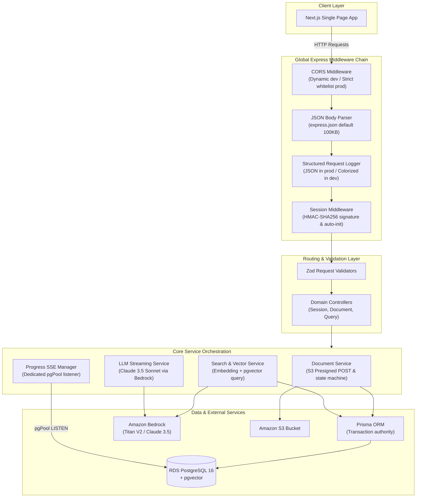

# API Service Overview

> High-concurrency TypeScript Express backend serving session authentication, S3 presigned upload dispatching, SSE progress streaming, and grounded RAG query orchestration.

---

## Architectural Role & Responsibilities

The API service (`apps/api`) functions as the edge-facing application gateway running on **Node.js 24 Alpine** within the Amazon EKS cluster. It is optimized for asynchronous, non-blocking I/O operations and long-lived HTTP streaming connections.

---

## Layered System Topology

The service strictly enforces separation of concerns across five decoupled tiers:

| Layer | Directory | Primary Responsibility |
|:---|:---|:---|
| **Routes** | `src/routes/` | Mounts HTTP path endpoints, attaches route-specific validators, and maps handler methods. |
| **Validators** | `src/validators/` | Validates incoming payloads before controller entry. |
| **Controllers** | `src/controllers/` | Unpacks request context, coordinates service invocations, and crafts HTTP status codes. |
| **Services** | `src/services/` | Contains all business logic, external SDK calls (S3, Bedrock), and database transactions. |
| **Data Layer** | `src/db.ts` | Houses Prisma ORM Client and standalone `pgPool` connection pools. |

---

## Middleware Execution Chain

Incoming requests traverse an ordered pipeline before reaching route handlers:

1. **CORS Middleware**: Evaluates origin against environment policies. Returns `Access-Control-Allow-Credentials: true` and caches preflight `OPTIONS` requests for 24 hours.
2. **Body Parsers**: Decodes JSON payloads using Express standard defaults (100KB) to prevent buffer exhaustion; file uploads bypass API memory entirely via direct S3 presigned POST.
3. **Structured Request Logger**: Intercepts request metadata, assigns correlation IDs, and logs execution latency.
4. **Session HMAC Middleware**: Validates the cryptographic cookie signature, auto-creates guest sessions if missing, and extends the 24-hour expiration window.
5. **Route Validators**: Blocks malformed requests before service dispatch.
6. **Centralized Error Handler**: Translates thrown business exceptions into RFC-compliant JSON responses with standard error codes.

---

## Production Invariants & Guardrails

- **Prisma ORM & Parameterized Vector SQL**: Standard relational reads, writes, and transactional state changes execute through Prisma ORM models. Because Prisma lacks native pgvector support (`Unsupported("vector(1024)")`), vector similarity searches execute via parameterized `prisma.$queryRaw` tagged templates with strict UUID tenant isolation.
- **Fail-Fast Request Validation**: Payloads failing schema or limit checks are rejected with descriptive HTTP 400/422 responses before invoking database or AWS SDK resources.
- **Graceful Lifecycle Management**: The process captures `SIGTERM` and `SIGINT` signals, closing open HTTP sockets, releasing `pgPool` connections, and disconnecting Prisma cleanly.
