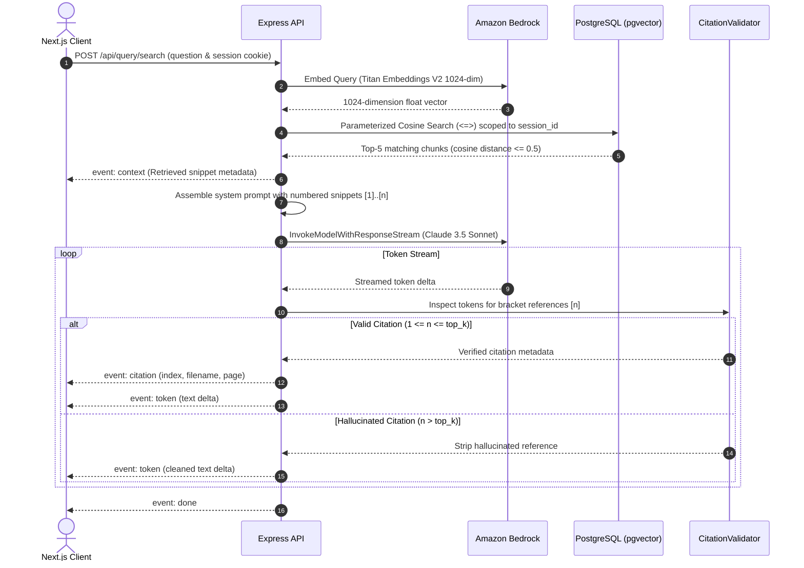

# Grounded Query & Citation Engine

> Tenant-partitioned vector similarity retrieval, Bedrock Claude 3.5 prompt construction, deterministic citation verification, and real-time SSE token streaming.

---

## Retrieval & Synthesis Flow

The query engine implements a strict Retrieval-Augmented Generation (RAG) loop over `POST /api/query/search`, grounding every AI-generated response in verified document snippets from the user's active session.

---

## Strategy Provider Architecture

Both embedding generation and LLM completion leverage the **Strategy Pattern** with environment-driven runtime factory instantiation:

| Role | Strategy Interface | Cloud Implementation | Local Emulation | Configuration Switch |
|:---|:---|:---|:---|:---|
| **Query Embedding** | `IEmbeddingProvider` | `BedrockEmbeddingProvider` (Amazon Titan Embeddings V2) | `LocalEmbeddingProvider` (E5-large-v2 with `query: ` prefix) | `EMBEDDING_PROVIDER=bedrock\|local` |
| **Response Generation** | `ILlmProvider` | `BedrockLlmProvider` (Claude 3.5 Sonnet via IRSA/Pod Identity) | `LocalLlmProvider` (Ollama streaming API / offline stub) | `LLM_PROVIDER=bedrock\|local` |

---

## Tenant-Partitioned Vector Search

To enforce absolute tenant isolation at the query execution boundary, vector searches use parameterized raw queries via Prisma Client:

- **Session Filtering**: Restricted strictly to the active authenticated tenant: `WHERE c.session_id = $1::uuid`.
- **Distance Operator**: Computes cosine distance using pgvector's `<=>` operator against the HNSW index.
- **Relevance Threshold**: Chunks with cosine distance exceeding `0.5` are discarded to prevent grounded synthesis over irrelevant context.
- **Top-K Limit**: Top 5 nearest neighbors are injected into the LLM synthesis context window.

---

## Deterministic Citation Verification

To prevent AI hallucination and ensure auditability, the system uses a streaming `CitationValidator`:

1. **Indexed Context**: Retrieved chunks are injected into the prompt with unambiguous labels: `[1] (Source: filename.pdf, Page: 4) ...`.
2. **Regex Stream Inspection**: Streamed token buffers are continuously scanned for citation patterns (`/\[(\d+)\]/g`).
3. **Bound Verification**: If Claude emits an index outside the range of injected snippets (`index > total_chunks`), the validator strips the hallucinated bracket from the user-facing text stream.
4. **Metadata Dispatch**: Valid citations trigger dedicated `event: citation` SSE frames containing exact document names, page numbers, and snippet content for interactive UI popovers.

---

## Client Disconnection Safety

If a user navigates away or cancels generation, the API's `req.on('close')` event triggers an `AbortController`. This immediately aborts the active Bedrock HTTP streaming connection, avoiding wasted token consumption and server compute.
