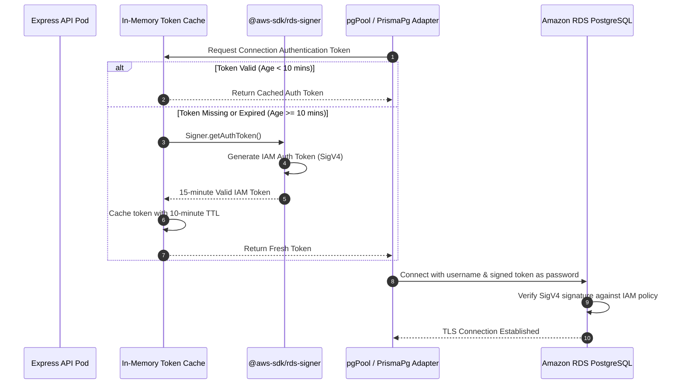

# RDS IAM Database Authentication

> Enterprise identity-based database authentication, eliminating static database credentials via EKS Pod Identity and cached AWS token signing.

---

## Architectural Problem & Solution

Traditional containerized microservices store static database passwords inside Kubernetes Secrets. If credentials are leaked or compromised, database access can be retained indefinitely. 

The API service eliminates static database passwords in AWS environments by authenticating to Amazon RDS PostgreSQL using **IAM Database Authentication tokens** via **EKS Pod Identity Associations**.

---

## Token Signing & Caching Mechanics

AWS RDS IAM tokens are temporary strings valid for exactly **15 minutes**. Generating a SigV4 signature on every connection request introduces unnecessary CPU overhead and AWS SDK latency.

### The 10-Minute Caching Strategy
Implemented in `src/utils/rds-auth.ts`:

- **Token Lifetime**: AWS tokens expire at 15 minutes.
- **Cache Invalidation**: The in-memory cache expires the token at **10 minutes**.
- **Buffer Window**: The 5-minute safety window guarantees that no connection attempt ever receives an expired or expiring token, even under heavy connection pool scaling.

---

## Prisma Driver Adapter Integration

Prisma ORM historically required a static connection string in `schema.prisma`. To enable dynamic password evaluation without recreating the Prisma Client on each connection:

1. **`@prisma/adapter-pg`**: The API instantiates a standard Node.js `pgPool` configured with dynamic password resolution.
2. **`PrismaPg` Driver Adapter**: The Prisma client wraps the `pgPool` instance, allowing Prisma to execute all ORM transactions over dynamically refreshed IAM connections.
3. **Environment Switching**: Controlled via `DB_IAM_AUTH_ENABLED=true|false`. When disabled (e.g. local Docker containers), standard static passwords are used without AWS SDK overhead.

---

## EKS Workload Identity Binding

The pod receives permission to connect via **EKS Pod Identity Associations**:

- **Service Account**: `api-service-account` in the application namespace.
- **IAM Permission**: `rds-db:connect` scoped strictly to `arn:aws:rds-db:{region}:{account}:dbuser:{db-resource-id}/{db-username}`.
- **Zero OIDC Overhead**: Managed directly by the node-level `eks-pod-identity-agent` daemonset without cluster-specific OIDC provider setup.
