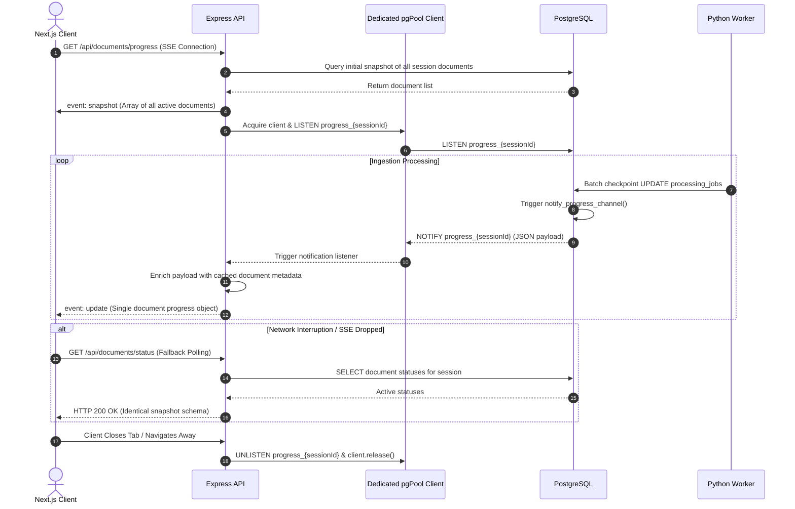

# Real-Time Ingestion Progress Engine

> Hybrid real-time push and polling architecture delivering granular document ingestion updates with kernel-level tenant isolation.

---

## Progress Notification Topology

To provide transparent progress monitoring across multi-file batch uploads, the API provides a **session-scoped Server-Sent Events (SSE)** endpoint backed by PostgreSQL `LISTEN/NOTIFY`.

---

## Named SSE Event Model

The SSE stream uses typed events conforming to the standard EventSource protocol:

| Event Type            | Payload Format                        | Delivery Trigger                                                                       |
| :-------------------- | :------------------------------------ | :------------------------------------------------------------------------------------- |
| **`event: snapshot`** | JSON array of all session documents   | Emitted strictly once immediately upon initial SSE connection establishment.           |
| **`event: update`**   | JSON object of an individual document | Emitted each time the database trigger detects status, progress, or chunk transitions. |

### Document Status Payload Structure

Both `snapshot` items and `update` frames share an identical schema contract:

- `documentId`: Target document UUID.
- `filename`: Original uploaded filename.
- `mimeType`: Media type (`application/pdf` or `text/plain`).
- `fileSizeBytes`: Total binary size in bytes.
- `status`: Active state machine value.
- `progressPct`: Percentage progress (0–100, capped at 99 until terminal completion).
- `processedChunks` / `totalChunks`: Processed vs total sliding-window chunk counts.
- `errorCode` / `errorMessage`: Failure codes populated on terminal failures.

---

## Payload Enrichment & Resource Management

1. **Kernel-Level Channel Isolation**: Notifications route over session-isolated channels (`progress_{sessionId}` with hyphens converted to underscores), eliminating Express-side filtering overhead.
2. **Metadata Caching**: PostgreSQL `NOTIFY` carries only transactional job fields. The Express handler enriches notifications using metadata cached during the initial snapshot query, preventing write amplification from secondary database lookups.
3. **Leak Prevention**: When a client closes the socket, the API immediately executes `UNLISTEN progress_{sessionId}` and returns the connection to `pgPool`.

---

## Senior Engineering Scalability Caveat

> **Operational Trade-Off**: Maintaining persistent database connections for `LISTEN/NOTIFY` requires dedicated connections outside RDS Proxy pooling (since RDS Proxy does not support `LISTEN/NOTIFY`). This architecture is optimal for designed concurrent tenant volumes. At massive enterprise scale (10,000+ concurrent connections), a distributed pub/sub broker like **Redis Pub/Sub** would decouple real-time socket broadcasting from the primary relational database.
