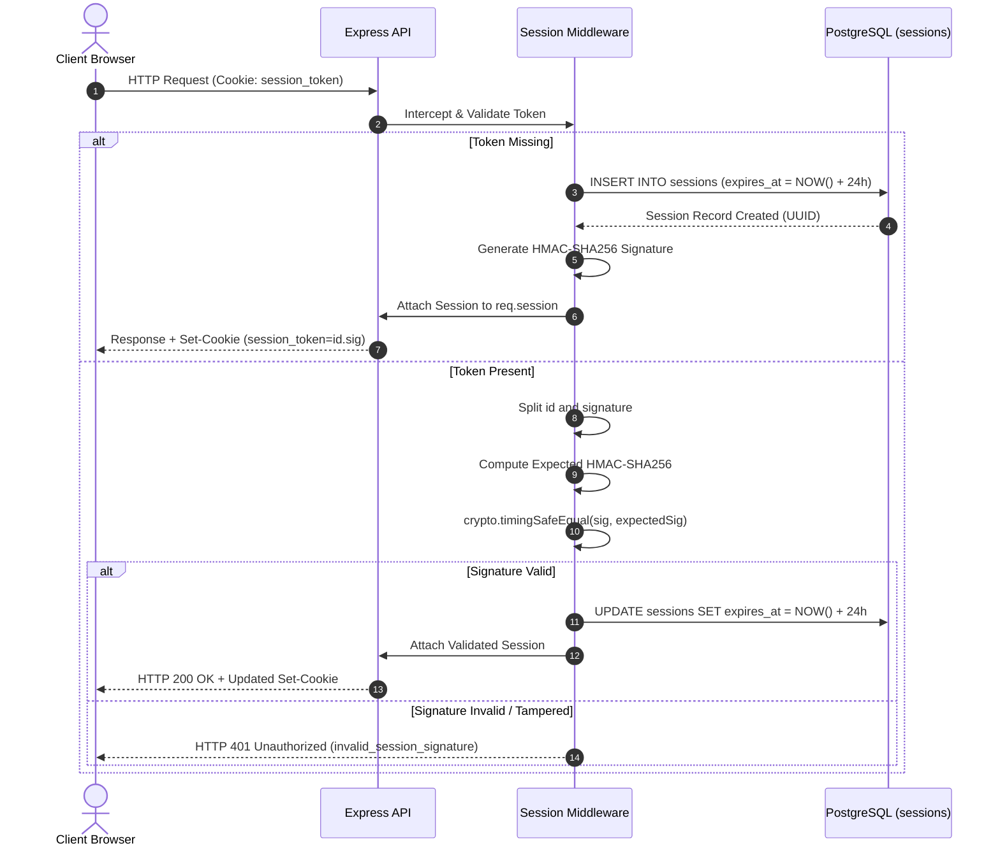

# API Session Management

> Stateless cryptographic session verification, constant-time HMAC validation, sliding-window expiration, and automatic guest provisioning.

---

## Authentication Mechanism

Multi-tenancy throughout the platform relies on **cryptographically signed session cookies** rather than centralized identity providers or stateful server sessions. Every incoming request is bound to an active tenant workspace via an HTTP-only cookie (`session_token`).

---

## Cryptographic Token Structure

The cookie payload consists of two period-separated segments:

- **Session Identifier**: Standard UUIDv4 identifying the active database record in the `sessions` table.
- **HMAC Signature**: Hex-encoded SHA-256 hash generated over the UUID using a server-side `SESSION_SECRET`.

### Security Protections

| Security Vector              | Implementation Mechanism    | Purpose                                                                                           |
| :--------------------------- | :-------------------------- | :------------------------------------------------------------------------------------------------ |
| **Timing Attack Mitigation** | `crypto.timingSafeEqual`    | Compares signature buffers in constant time, preventing byte-by-byte timing inference.            |
| **XSS Exfiltration Defense** | `HttpOnly: true`            | Prevents malicious client-side JavaScript from reading or exporting session tokens.               |
| **CSRF Mitigation**          | `SameSite: Lax`             | Blocks unauthorized third-party cross-site request forgery while preserving top-level navigation. |
| **Transport Encryption**     | `Secure: true` (Production) | Enforces cookie transmission exclusively over TLS/HTTPS connections.                              |

---

## Lifecycle & Sliding-Window Renewal

1. **Auto-Initialization**: When a user arrives without a cookie, `GET /api/session` automatically provisions a fresh session record and issues the signed cookie, eliminating registration friction.
2. **Sliding-Window Renewal**: On every valid authenticated interaction, the session middleware updates `expires_at` by an additional 24 hours in both the database and the HTTP `Set-Cookie` header.
3. **Session Purging & Cascade**: When an inactive session passes its 24-hour expiration threshold, background cleanup tasks purge the session record. Relational cascading foreign keys (`ON DELETE CASCADE`) automatically wipe all associated documents, processing jobs, vector chunks, and query logs.
