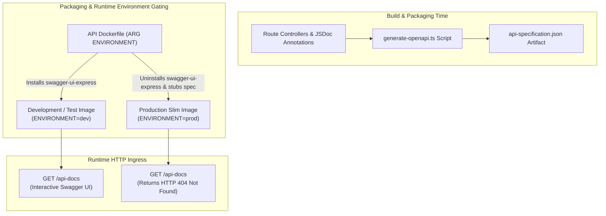

# OpenAPI Specification & Swagger UI

> Automated OpenAPI 3.0 documentation generation, interactive developer testing, and production attack surface elimination.

---

## Architectural Strategy

The Express API implements automated API documentation to maintain synchronization between TypeScript route definitions and consumer integration contracts without requiring manually maintained YAML files.

---

## Contract Declaration & Component Schemas

All endpoint contracts are declared as JSDoc annotations directly adjacent to route handlers, using standard OpenAPI 3.0 syntax:

- **Security Schemes**: Declares `CookieAuth` using HTTP cookie `session_token`.
- **Reusable Component Schemas**: Centrally defined in `src/config/swagger.ts`, including `DocumentStatusObject`, `BatchUploadResult`, and `ErrorResponse`.
- **Automated Specification Export**: The CLI script `npm run api:docs:generate` evaluates the JSDoc annotations and generates a validated JSON artifact (`docs/context/api-specification.json`).

---

## Development vs Production Isolation

To prevent internal architectural intelligence leakage in production environments, the system applies defense-in-depth isolation:

| Environment              | Swagger UI Status | Package Status                   | Spec File                   | HTTP Response                  |
| :----------------------- | :---------------- | :------------------------------- | :-------------------------- | :----------------------------- |
| **Local / Development**  | Enabled           | `swagger-ui-express` bundled     | Full OpenAPI JSON           | `HTTP 200 OK` (Interactive UI) |
| **Staging / Production** | Disabled          | `swagger-ui-express` uninstalled | Stubbed empty object (`{}`) | `HTTP 404 Not Found`           |

---

## Container Build Packaging Mechanics

During Docker multi-stage compilation:

1. **Development Image (`ENVIRONMENT=dev`)**: Generates `/app/swagger.json` and preserves `swagger-ui-express` dependencies for local developer verification.
2. **Production Image (`ENVIRONMENT=prod`)**: Purges `swagger-ui-express` from `node_modules` via `npm uninstall`, writes an empty stub to `/app/swagger.json`, and compiles a hardened slim container.
