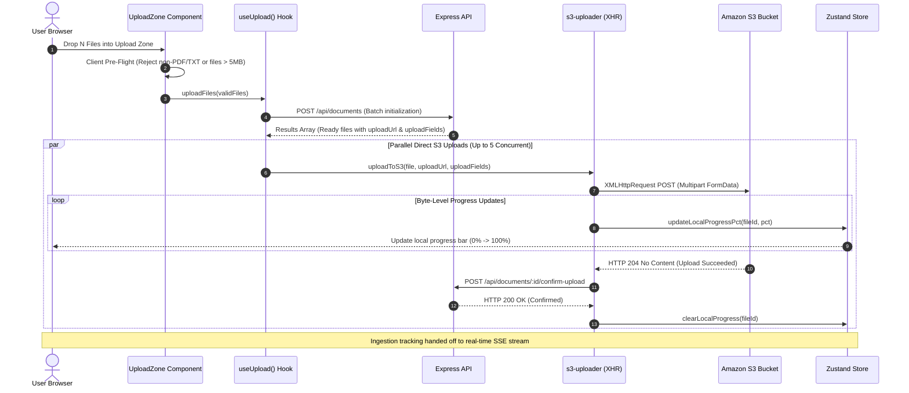

# Batch Upload & S3 Ingestion Flow

> Multi-file drag-and-drop target, client-side pre-flight checks, direct S3 multipart uploading, and backend confirmation handoff.

---

## Direct Upload Architecture

Rather than proxying multi-megabyte binary documents through the API server, the frontend uploads files directly from the browser to Amazon S3 via presigned POST policies, maintaining smooth real-time byte progress.

---

## Client-Side Pre-Flight Checks (`UploadZone`)

Before making network calls, `UploadZone.tsx` validates files locally:

- **Format Filtering**: Rejects unsupported formats (images, Word documents, executables) immediately with a toast notification.
- **Size Bounds**: Flags files exceeding 5 MB (5,242,880 bytes).
- **Concurrency Locking**: If the active document count in the registry equals or exceeds 5, the drop target dims opacity, disables file picker interaction, and shows a concurrency limit warning.

---

## Batch Queue Orchestrator (`useUpload`)

The upload hook coordinates multi-file batch execution:

1. **Batch Contract**: Groups all valid selected files into a single `POST /api/documents` payload.
2. **Response Classification**:
   - `rejected` files: Stored directly into the document registry with inline error codes (`file_too_large`, `invalid_mime_type`) and displayed in the feed.
   - `ready` files: Added to `localProgressQueue` and passed to the S3 uploader pool.
3. **Modal Dialog Alerts**: If batch-level concurrency or storage quotas are exceeded, the hook presents a glassmorphic dialog detailing exact limit thresholds.

---

## Direct S3 Multipart Uploader (`s3-uploader.ts`)

Direct file transfers use native `XMLHttpRequest` rather than standard `fetch`, as `fetch` lacks an `onprogress` upload event:

- **FormData Sequence Invariant**: Amazon S3 requires all presigned policy fields to appear **before** the binary file payload in the multipart body. `s3-uploader.ts` appends all `uploadFields` key-values first and appends `file` as the final parameter.
- **Upload Progress Callback**: Listens to `xhr.upload.onprogress` events, computing `(loaded / total) * 100` and updating Zustand's `localProgressQueue`.
- **Confirmation Handback**: Upon receiving `204 No Content` from S3, the uploader immediately calls `POST /api/documents/:id/confirm-upload`. Once confirmed, the file is cleared from local progress and transitions to backend tracking.
