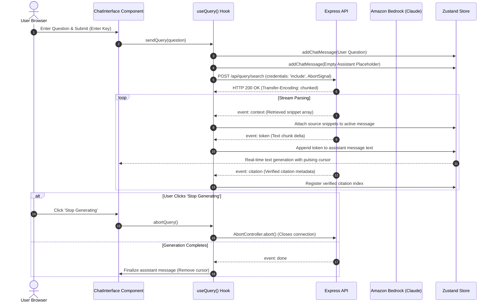

# Conversational Q&A & Streaming Chat

> Real-time token streaming via fetch ReadableStream, client-side AbortController cancellation, and responsive chat bubble rendering.

---

## Streaming Architecture

Because the conversational search endpoint (`POST /api/query/search`) requires an HTTP POST body carrying the user's question, standard browser `EventSource` (which only supports GET) cannot be used. The frontend instead uses `fetch` with a `ReadableStream` reader.

---

## ReadableStream SSE Reader (`useQuery`)

Implemented in `src/hooks/useQuery.ts`:

- **Stream Decoding**: Reads the incoming UTF-8 byte stream using `response.body.getReader()`, splitting buffer lines on `\n\n` delimiters.
- **Event Frame Dispatcher**:
    - `event: context`: Delivers the top-5 retrieved context passages.
    - `event: token`: Appends incremental text deltas to the active assistant response.
    - `event: citation`: Binds citation metadata (document name, page number, relevance match) to the message.
    - `event: done`: Closes the active generation cycle.
    - `event: error`: Renders inline conversational alert banners on stream interruptions.
- **AbortController Invariant**: Every query binds an `AbortController`. If a user clicks "Stop Generating" or navigates away, the signal aborts the request, notifying Express to close the Bedrock stream immediately.

---

## Interactive Chat Layout (`ChatInterface`)

The chat workspace provides a fluid conversational interface:

- **Viewport Auto-Scroll**: Automatically scrolls smoothly to the latest streaming token while allowing users to scroll up to inspect previous answers without snapping.
- **Auto-Resizing Prompt Input**: Textarea grows dynamically with multi-line prompts. `Enter` submits the question, while `Shift+Enter` inserts newlines.
- **Prompt Suggestion Pills**: Surfaces common document discovery prompts when chat history is empty.
- **Streaming Pulse Indicator**: Displays an animated pulse indicator while the assistant message is receiving active token chunks.
