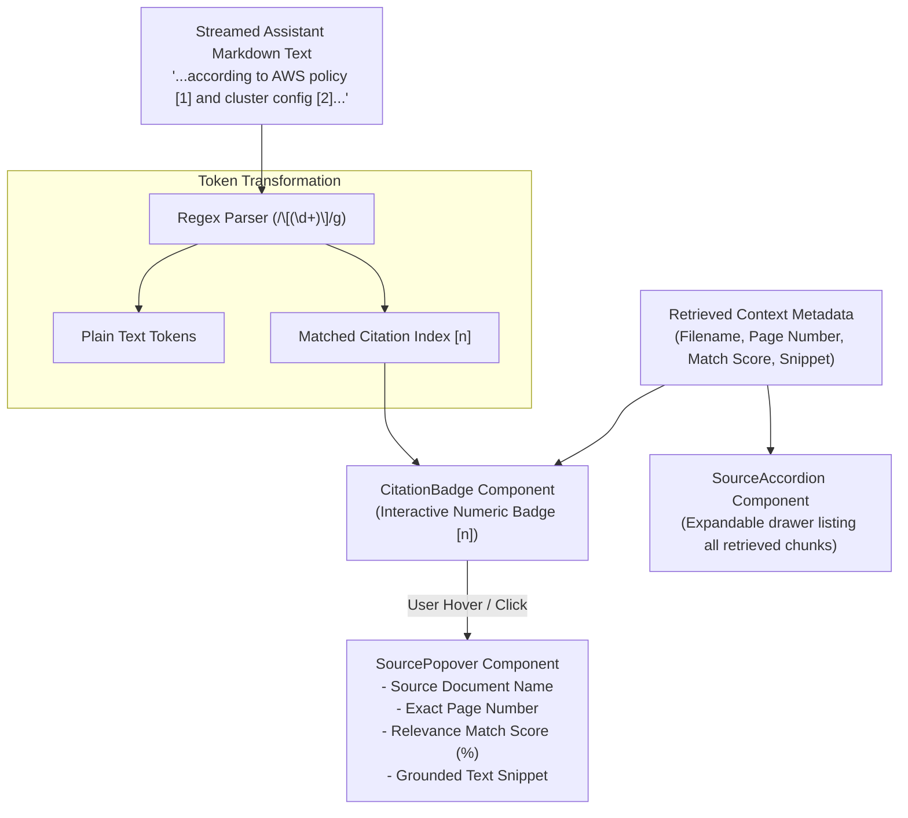

# Interactive Citation System

> Real-time inline citation badge rendering, interactive hover popover inspection, and expandable source context panels.

---

## Citation Architecture

To establish auditability in enterprise document intelligence, every factual claim generated by the LLM is anchored to source document citations. The frontend transforms textual bracket notations (`[1]`, `[2]`) into interactive user interface elements.

---

## Component Ecosystem

The citation visualization architecture consists of three specialized components:

| Component | File Path | Interaction & Role |
|:---|:---|:---|
| **`CitationBadge`** | `src/components/chat/citation-badge.tsx` | Renders a styled, interactive numeric badge (`[1]`, `[2]`) in-line with the assistant prose. |
| **`SourcePopover`** | `src/components/chat/source-popover.tsx` | Floating card revealed upon hover or tap, displaying source filename, page number, relevance score, and the exact contextual passage. |
| **`SourceAccordion`** | `src/components/chat/source-accordion.tsx` | Expandable panel affixed beneath the assistant answer, listing all retrieved candidate snippets for comprehensive source auditing. |

---

## Token Parsing & Citation Hydration

Implemented in `src/components/chat/chat-bubble.tsx`:

1. **Regex Scanning**: The message content is split along bracket patterns (`/\[(\d+)\]/g`).
2. **Citation Hydration**: Matched numbers are mapped against the message's `citations` dictionary received from the backend `event: citation` stream.
3. **Hallucination Immunity**: If the LLM generates a bracket reference that was stripped or unverified by the backend `CitationValidator`, the token renders as benign plain text rather than an active citation badge.
4. **Relevance Scoring**: Cosine distance values (`0.0` to `0.5`) are normalized into intuitive similarity percentage scores (`100%` to `50%`) displayed directly inside the source popover.
