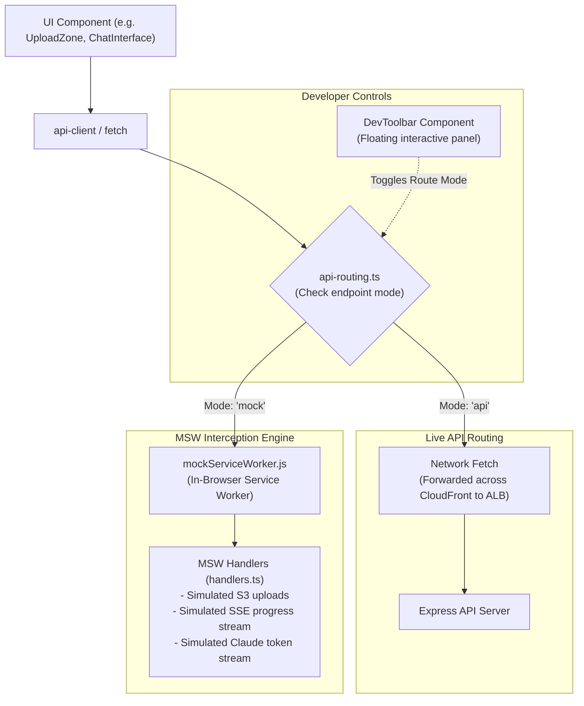

# MSW Hybrid Mocking Engine

> Granular endpoint routing, in-browser Mock Service Worker interception, and interactive developer toolbar inspection.

---

## Hybrid Routing Architecture

To enable offline frontend development without depending on running backend API servers or AWS cloud resources, the application incorporates a **hybrid interception router** powered by **Mock Service Worker (MSW v2)**.

---

## Granular Endpoint Routing Matrix

Defined in `src/config/api-routing.ts`, developers can independently toggle individual route domains between live backend execution and local mock simulation:

| Domain Key      | Endpoint Route            | Mock Behavior                                                                                                                    |
| :-------------- | :------------------------ | :------------------------------------------------------------------------------------------------------------------------------- |
| **`session`**   | `/api/session`            | Generates deterministic session UUIDs and mock cookies.                                                                          |
| **`documents`** | `/api/documents*`         | Validates file limits, simulates presigned POST URLs, and supports simulated error injections (quota exceeded, 429 concurrency). |
| **`progress`**  | `/api/documents/progress` | Simulates Server-Sent Events emitting stage progression (`downloading` -> `extracting` -> `completed`).                          |
| **`query`**     | `/api/query/search`       | Streams simulated LLM responses with realistic token delays and citation references.                                             |

---

## Interactive Developer Toolbar (`DevToolbar`)

Available exclusively during local development (`process.env.NODE_ENV !== 'production'`):

- **Floating Interface**: Positioned unobtrusively in the viewport corner.
- **Per-Route Toggles**: Dropdown selectors switch each endpoint between `'api'` and `'mock'` instantaneously without requiring server restarts or bundle rebuilds.
- **Preset Configurations**: Quick-select buttons enable _"All Live"_ (full backend parity) or _"All Mock"_ (100% offline development).
- **Production Stripping**: The toolbar component and MSW service worker registrations are completely stripped from production build bundles.
