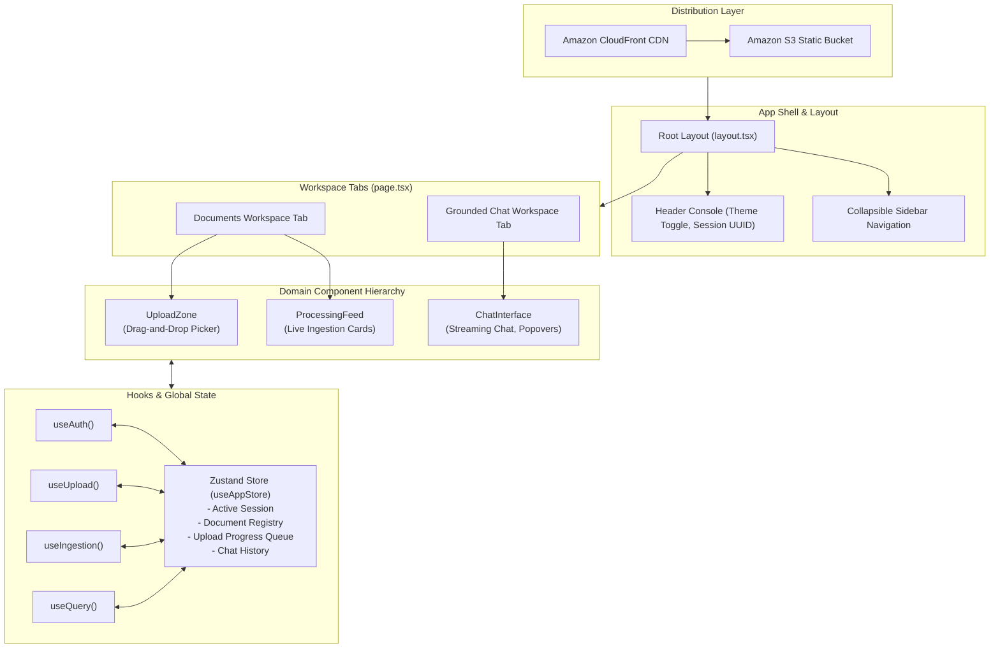

# Frontend Application Overview

> Statically exported Next.js 16 single-page application featuring batch drag-and-drop uploads, real-time ingestion feeds, and streaming grounded chat with interactive citations.

---

## Architectural Role & Distribution

The frontend application (`apps/frontend`) runs as a decoupled Single Page Application (SPA) built with **Next.js 16.2 App Router**, **React 19**, and **Tailwind CSS v4**.

Compiled with static export (`output: 'export'`), the application builds into pure static assets (`HTML`, `CSS`, `JS`) served globally from **Amazon S3** through **Amazon CloudFront**. This eliminates in-cluster Node.js server overhead, leverages CloudFront's permanent free tier (1 TB egress/mo and 10M requests) for negligible baseline hosting costs (<$3.00/month), and scales elastically with global edge bandwidth on demand.

---

## Component & Directory Structure

The frontend workspace adheres to a modular component architecture:

| Directory                   | Role                     | Key Modules                                                                                                  |
| :-------------------------- | :----------------------- | :----------------------------------------------------------------------------------------------------------- |
| `src/app/`                  | Next.js App Router root  | `layout.tsx` (Root shell), `page.tsx` (Dashboard view with Documents & Chat tabs).                           |
| `src/components/layout/`    | Shell components         | `app-shell.tsx`, `sidebar.tsx`, `header.tsx`.                                                                |
| `src/components/upload/`    | Ingestion ingress        | `upload-zone.tsx` (Drag-and-drop file target with concurrency locking).                                      |
| `src/components/documents/` | Ingestion monitoring     | `processing-feed.tsx`, `document-card.tsx` (Granular stage badges, progress bars, orphan retry).             |
| `src/components/chat/`      | Conversational RAG       | `chat-interface.tsx`, `chat-bubble.tsx`, `citation-badge.tsx`, `source-popover.tsx`, `source-accordion.tsx`. |
| `src/hooks/`                | Business lifecycle hooks | `useAuth.ts`, `useUpload.ts`, `useIngestion.ts`, `useQuery.ts`.                                              |
| `src/store/`                | Global state registry    | `useAppStore.ts` (Zustand client state).                                                                     |
| `src/lib/`                  | Low-level utilities      | `api-client.ts`, `s3-uploader.ts`, `sse-client.ts`.                                                          |

---

## State Management Architecture (Zustand)

Global client state is centralized in `useAppStore.ts` to coordinate interactions across views without prop-drilling:

- **Session State**: Holds active session UUID, sliding expiration timestamps, and authenticated status.
- **Document Registry**: Key-value dictionary (`Record<string, DocumentStatusObject>`) storing backend processing states updated by SSE frames and polling.
- **Local Progress Queue**: Tracks active browser-to-S3 XHR upload byte transfers before backend confirmation.
- **Chat State**: Ordered list of conversational messages, active streaming tokens, and verified citation references.
- **UI State**: Sidebar expansion toggles and light/dark theme persistence.
