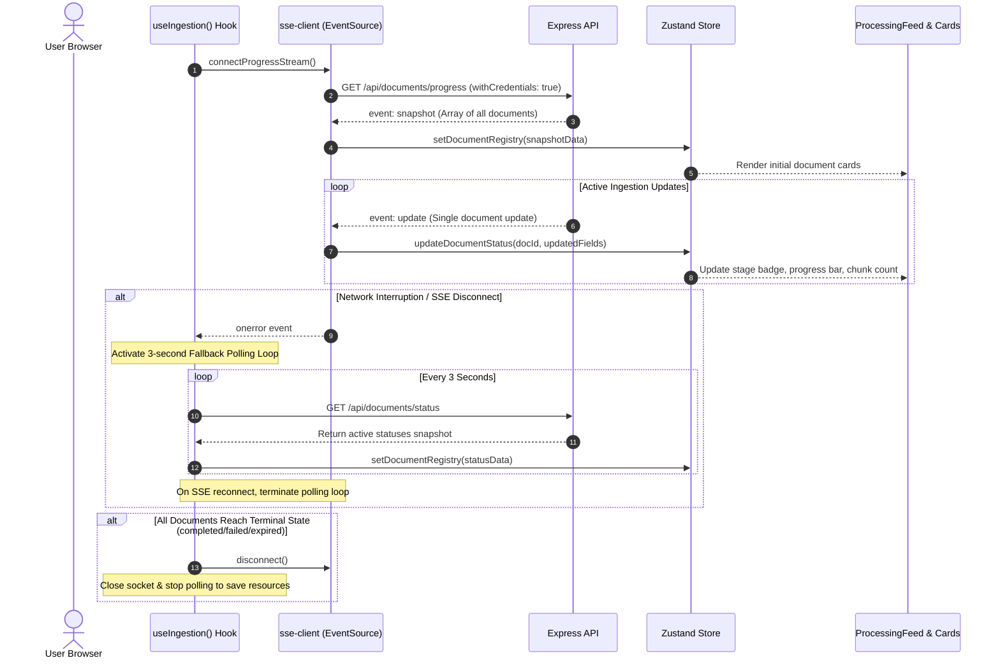

# Frontend Real-Time Progress Visualizer

> Real-time Server-Sent Events monitoring, automated polling failover, lifecycle teardown, and granular stage progress cards.

---

## Real-Time Ingestion Architecture

Once files are uploaded to S3, client-side monitoring switches from byte-level upload progress to the server-side ingestion lifecycle via **Server-Sent Events (SSE)**.

---

## EventSource Wrapper (`sse-client.ts`)

Built around standard browser `EventSource` with custom resiliency logic:

- **Credentials Invariant**: Configured with `withCredentials: true` to forward session cookies across origins.
- **Typed Event Listeners**:
    - `snapshot`: Populates or resets the entire Zustand document dictionary upon connection.
    - `update`: Incrementally updates an individual document record in place.
- **Heartbeat & Reconnection**: Standard browser EventSource mechanisms automatically attempt reconnection if network connectivity drops.

---

## Resilient Failover & Lifecycle (`useIngestion`)

Implemented in `src/hooks/useIngestion.ts`:

1. **3-Second Fallback Polling**: If the SSE connection encounters network errors or corporate firewall proxy blocking, the hook immediately activates a 3-second fallback interval calling `GET /api/documents/status`.
2. **Automatic Teardown**: As soon as the SSE connection recovers (`onopen`), the polling loop is destroyed.
3. **Smart Inactive Teardown**: If every document in the session reaches a terminal state (`completed`, `failed`, `expired`, `cancelled`), the hook automatically tears down both the SSE connection and polling intervals to conserve device battery and server connection limits.

---

## Modular Feed & Progress Cards (`ProcessingFeed` & `DocumentCard`)

Ingestion progress is visualized using dedicated UI cards:

- **Lifecycle Stage Badges**: Displays distinct styled badges mapping to active state machine phases (`Downloading`, `Validating`, `Extracting`, `Chunking`, `Embedding`, `Completed`).
- **Granular Sub-Stage Indicators**:
    - During chunking: Displays extracted chunk counters (`"Chunking (4 of 8 chunks)..."`).
    - During embedding: Displays calculated percentage progress bars (`"Embedding (50% complete)..."`).
- **Orphan Ingestion Interceptor**: If a document transitions to `failed` or `expired`, the card renders an amber/red warning glow, presents detailed error diagnostics, and provides **Dismiss** (removes card) and **Retry** (prompts file re-selection) actions.
