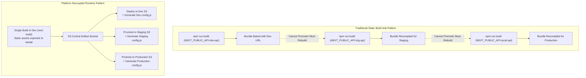
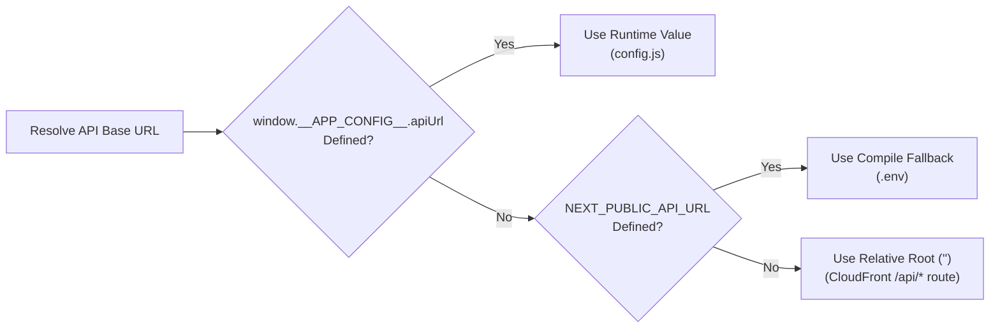

# Decoupled Runtime Configuration

> Decoupled runtime configuration injection, eliminating compile-time environment coupling, and enabling build-once static artifact promotion.

---

## The Compile-Time Coupling Anti-Pattern

In conventional Next.js applications, environment variables prefixed with `NEXT_PUBLIC_*` are statically evaluated and inlined into JavaScript bundles during `next build`.

This creates a critical cloud deployment vulnerability: promoting a static build from staging to production requires **recompiling the entire application** to update backend endpoints, violating artifact immutability.

---

## The `/config.js` Runtime Pattern

To achieve strict artifact immutability, the platform decouples configuration from the compiled JavaScript chunks:

1. **Root Script Tag**: In `src/app/layout.tsx`, the root layout injects an un-hashed script before hydration:
   `<Script src="/config.js" strategy="beforeInteractive" />`
2. **Global Window Augmentation**: When executed, `config.js` sets `window.__APP_CONFIG__`:
   - `apiUrl`: Target Express API base URL.
   - `environment`: Active deployment environment (`dev`, `stg`, `prod`).
3. **TypeScript Typing**: Strongly typed in `src/types/config.d.ts` by augmenting the global `Window` interface.

---

## Priority Resolution Chain

Implemented in `src/lib/api-client.ts` and `src/config/api-routing.ts`:

---

## CI/CD Deployment & Caching Invariants

Executed in `.github/workflows/frontend-deploy.yml`:

- **Immutable Hashed Chunks**: Compiled JS and CSS chunks containing content hashes are uploaded with permanent caching headers:
  `Cache-Control: public, max-age=31536000, immutable`
- **Dynamic Runtime Config**: The workflow dynamically generates `config.js` during deployment and uploads it with edge-cached, browser-revalidating headers:
  `Cache-Control: public, max-age=0, s-maxage=86400, must-revalidate`
- **CloudFront Invalidation**: An explicit invalidation (`/*`) purges edge caches, ensuring visitors immediately receive the latest runtime configuration without stale endpoint locks.
