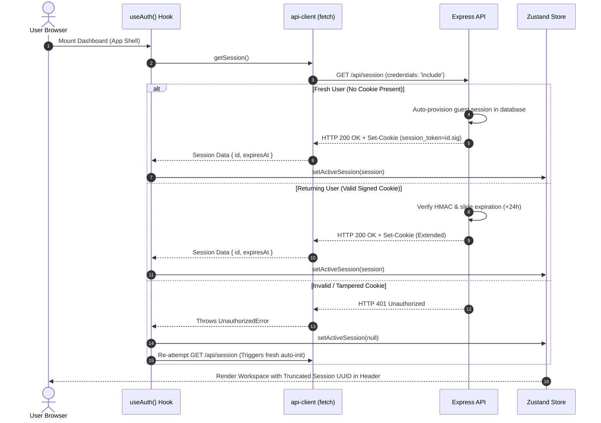

# Frontend Session & Authentication Flow

> Frictionless tenant bootstrapping, credentials inclusion, automatic session provisioning, and reactive Zustand synchronization.

---

## Session Lifecycle Flow

The frontend does not require login forms or credential prompts. Multi-tenant workspace isolation is bootstrapped automatically through the `useAuth` hook upon initial client mount.

---

## Client Fetch & Credentials Handling

Implemented in `src/lib/api-client.ts`:

- **Credentials Policy**: All network fetches set `credentials: 'include'`, ensuring browsers attach the signed `session_token` cookie across cross-origin requests.
- **Typed API Responses**: Maps incoming payloads to TypeScript interfaces (`SessionResponse`, `ErrorResponse`).
- **Custom Error Hierarchy**: Automatically converts HTTP error payloads into structured class instances (`UnauthorizedError`, `StorageQuotaExceededError`, `RateLimitExceededError`, `ConcurrencyLimitExceededError`).

---

## Workspace Visibility & Header Integration

The active session state informs UI layout components:

- **Header Console**: Displays a truncated representation of the active session UUID (e.g. `550e8400...`) along with the live countdown timer until session expiration.
- **Quota Monitors**: Computes real-time usage metrics against session allowances:
    - Active Upload Slots: Current in-flight documents vs 5 max.
    - Cumulative Storage: Current megabytes occupied vs 50 MB allowance.
- **Re-Validation**: Periodically queries session status to keep the sliding-window expiration active while the browser tab remains in focus.
