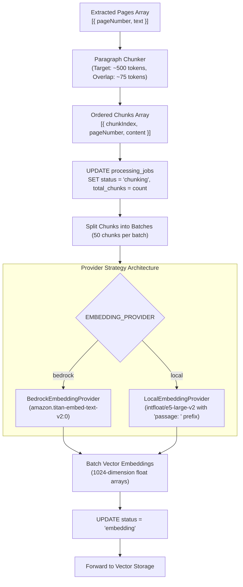

# Text Chunking & Embedding Generation

> Context-preserving text chunking, Bedrock Titan V2 vectorization, exponential retry backoff, and local model parity.

---

## Processing Architecture

Once document text is extracted, the worker divides continuous prose into overlapping segments and converts them into dense dimensional vector representations for storage in PostgreSQL.

---

## Sliding-Window Paragraph Chunking

Implemented in `app/services/chunker.py`:

- **Target Chunk Size**: Approximately **500 tokens** (~2,000 characters), sized to fit within embedding context windows while providing rich context for RAG retrieval.
- **Contextual Overlap**: **75 tokens** (~300 characters) carried over between adjacent chunks to prevent cutting critical concepts, sentences, or names at boundaries.
- **Metadata Retention**: Every chunk maintains its origin metadata:
    - `chunk_index`: 0-indexed sequential position within the document.
    - `page_number`: 1-indexed document page where the chunk text originated.
    - `content`: Extracted text snippet.

---

## Embedding Provider Strategy & E5 Convention

Embeddings are generated via a Strategy pattern conforming to `EmbeddingProvider`:

| Environment              | Provider Class             | Model                          | Dimensions | Prefix Convention   |
| :----------------------- | :------------------------- | :----------------------------- | :--------- | :------------------ |
| **Production / Staging** | `BedrockEmbeddingProvider` | `amazon.titan-embed-text-v2:0` | 1024       | None                |
| **Local / Test**         | `LocalEmbeddingProvider`   | `intfloat/e5-large-v2`         | 1024       | `"passage: {text}"` |

### Asymmetric E5 Query-Document Invariant

When running offline models (e5-large-v2), bi-encoders require distinct instruction prefixes:

- **Worker Ingestion**: Prefixes chunks with `passage: ` before embedding into pgvector.
- **API Retrieval**: Prefixes user queries with `query: ` before computing cosine similarity.

---

## Batch Processing & Throttling Mitigations

To avoid hitting AWS Bedrock throughput ceilings:

- **Batch Size**: Chunks are processed in batches of **50 items**.
- **Exponential Backoff**: Calls to Bedrock Runtime are wrapped in retry logic catching `ThrottlingException` and `ServiceUnavailableException`. Retries execute with exponential backoff (initial delay 1.0s, backoff multiplier 2.0x, maximum 3 retries).
- **Progress Tracking**: Once chunking completes, the worker updates `processing_jobs.total_chunks`, establishing the progress denominator for subsequent batch updates.
