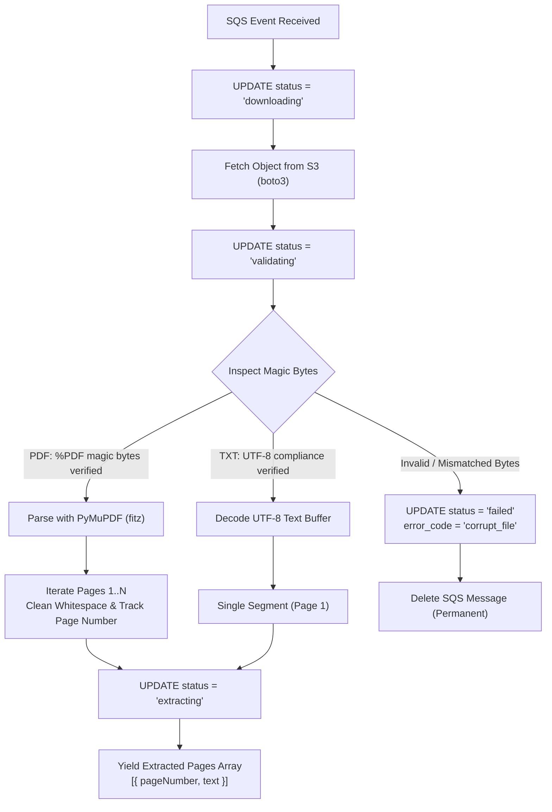

# Document Extraction Pipeline

> Secure S3 file retrieval, magic byte format verification, and page-by-page text extraction via PyMuPDF.

---

## Extraction Lifecycle

The extraction service (`app/services/extractor.py`) verifies the integrity of files uploaded to Amazon S3, confirms their binary format, and parses raw textual content page-by-page before passing it to the chunking pipeline.

---

## Magic Byte Inspection & Content Security

Web clients can spoof MIME types during upload. To ensure parser security, the worker never trusts the uploaded `Content-Type` header blindly:

| Expected Format | Inspection Rule | Failure Action |
|:---|:---|:---|
| **PDF Documents** | First 4 bytes must match `%PDF` (`0x25 0x50 0x44 0x46`). | Rejects spoofed files (e.g. executables renamed to `.pdf`) as `corrupt_file`. |
| **Plain Text Files** | Verifies strict UTF-8 decoding without byte errors. | Rejects binary or non-UTF-8 character encodings as `unsupported_encoding`. |

---

## PyMuPDF Text Parsing Architecture

Document text extraction uses **PyMuPDF (`fitz`)**, selected for minimal CPU overhead, low memory footprint, and fast C-native text parsing:

- **Page-Level Segmentation**: Iterates through the document page-by-page, recording 1-indexed page numbers alongside raw text buffers.
- **Whitespace Normalization**: Trims trailing carriage returns, collapses multiple spaces, and filters empty scanned pages.
- **Corrupt File Exception Handling**: If a PDF is structurally damaged or truncated, PyMuPDF raises `FileDataError`. The worker catches this exception, marks the job as `failed` with code `corrupt_pdf`, and terminates processing without infinite retries.

---

## Status Progression

During extraction, the database `processing_jobs.status` reflects the following state machine transitions:

1. `downloading`: The worker has acquired the SQS message and initiated S3 file streaming.
2. `validating`: S3 download is complete; magic bytes and UTF-8 decoders are verifying binary format.
3. `extracting`: Validation passed; PyMuPDF is parsing document pages.
