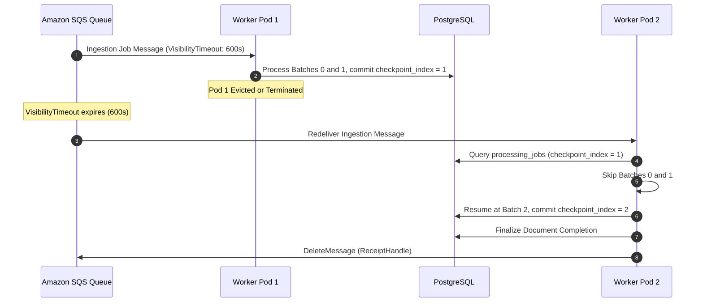

# Worker Idempotency & Checkpoint Resumption

> Resilient distributed document processing, exactly-once logical semantics, mid-flight crash recovery, and batch checkpoint resumption.

---

## The Distributed Failure Problem

In cloud-native Kubernetes environments, worker pods are subject to abrupt terminations caused by **KEDA scale-down events**, **EKS Spot Instance reclamation**, and **node drains**.

Without idempotency and checkpointing, an interrupted 500-page document processing job would either:

1. Fail completely and leave corrupt partial chunks in the vector store.
2. Restart from page 1 on a new pod, duplicating vector records and incurring redundant Bedrock embedding API billing.

---

## Three-Tier Idempotency Strategy

The worker implements a layered defense ensuring crash resiliency:

| Mechanism                          | Implementation Detail                                            | Guarantee Provided                                                                                                                                                                       |
| :--------------------------------- | :--------------------------------------------------------------- | :--------------------------------------------------------------------------------------------------------------------------------------------------------------------------------------- |
| **1. Composite Upsert Key**        | `UNIQUE (document_id, chunk_index)` with `ON CONFLICT DO UPDATE` | Re-running any chunk batch safely updates records in place without duplicating database rows.                                                                                            |
| **2. Checkpoint Resume**           | `checkpoint_index` on `processing_jobs` table                    | Tracks the last successfully committed batch (e.g., batch 4). On restart, the worker skips directly to batch 5, avoiding redundant Bedrock embedding costs.                              |
| **3. Distributed Visibility Lock** | 600-second SQS `VisibilityTimeout`                               | SQS conceals the in-flight message from other pods during processing without requiring external distributed locks (e.g. Redis Redlock). If the pod dies, the lock expires automatically. |

---

## Failure Recovery Scenarios

The system recovers deterministically across failure modes:

- **Crash During S3 Download / Validation**: Status remains `pending_upload` or `downloading`. When redelivered, the replacement pod restarts download cleanly.
- **Crash Mid-Embedding (Batch N)**: Batches `0` through `N-1` are already committed with `checkpoint_index = N-1`. The replacement pod extracts text, chunks the document, skips batches `0..N-1`, and resumes embedding at batch `N`.
- **Session Expired During Processing**: If a user session expires and is purged via foreign key cascade while a worker is active, the worker catches SQLAlchemy `NoResultFound` and gracefully deletes the SQS message without re-raising.
