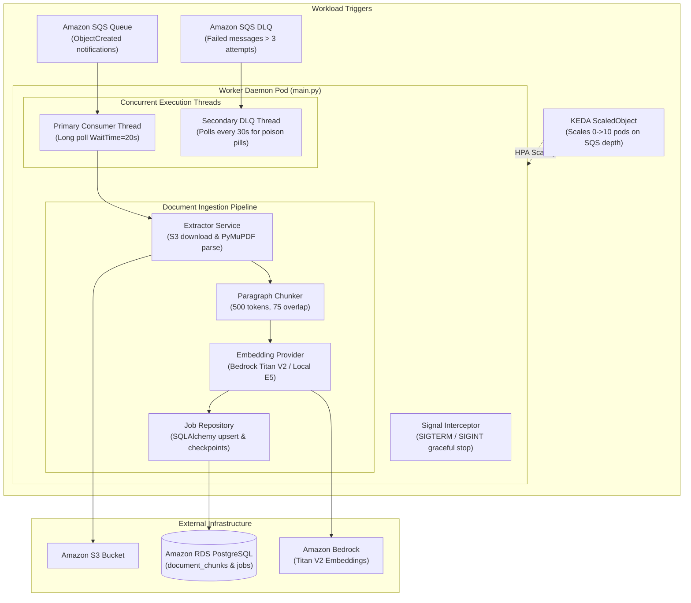

# Worker Service Overview

> Decoupled Python processing daemon executing S3 document downloading, format validation, text extraction, sliding-window chunking, vector embedding, and resilient database storage.

---

## Architectural Role & Responsibilities

The worker service (`apps/worker`) operates as a decoupled background consumer built on **Python 3.11 Slim**. It scales dynamically from **0 to 10 pods** on Amazon EKS via KEDA based on Amazon SQS queue depth, ensuring zero idle compute costs when no ingestion workloads are pending.

---

## Component Topology

The codebase is organized into modular layers:

| Layer | Directory / Module | Role |
|:---|:---|:---|
| **Entry Point** | `main.py` | Initializes clients, registers OS signal handlers, spawns the DLQ poller thread, and runs the SQS loop. |
| **Consumer** | `app/consumers/sqs_consumer.py` | Polls SQS with long polling (`WaitTimeSeconds=20`), validates S3 event schema, and controls message deletion. |
| **Handler** | `app/handlers/job_handler.py` | Orchestrates document status transitions across the ingestion lifecycle. |
| **Extractor** | `app/services/extractor.py` | Downloads files from S3, validates magic numbers, and extracts text using PyMuPDF. |
| **Chunker** | `app/services/chunker.py` | Splits raw text into paragraph-aware chunks (~500 tokens, 75 overlap). |
| **Embeddings** | `app/services/embeddings.py` | Converts text chunks into 1024-dimension float vectors via Bedrock Titan V2 or local models. |
| **Repository** | `app/repositories/job_repository.py` | Manages PostgreSQL transactions, chunk upserts, progress updates, and completion flags via SQLAlchemy. |

---

## Graceful Shutdown & Resiliency Mechanics

When Kubernetes schedules a pod termination (e.g., node drain, spot interruption, or KEDA scale-in):

1. **Signal Interception**: A `SIGTERM` handler sets `shutdown_requested = True`.
2. **Loop Termination**: The consumer loop stops pulling new messages from SQS.
3. **In-Flight Protection**: Active message processing is allowed to proceed until the current batch commits.
4. **Visibility Timeout Guarantee**: If the pod is killed before finishing the document, the SQS message is **not** deleted. Once its visibility timeout (600s) elapses, SQS releases the message to a surviving pod, which resumes processing from `checkpoint_index + 1`.
