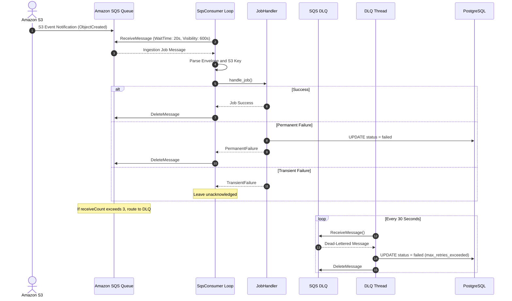

# SQS Consumer & DLQ Bridge

> Asynchronous SQS long-polling consumer, visibility timeout management, transient vs permanent error routing, and DLQ state synchronization.

---

## Consumer Polling Architecture

The SQS consumer decouples file upload arrival from compute-intensive text extraction. It consumes S3 event notifications from Amazon SQS using the AWS Boto3 SDK, balancing throughput and infrastructure cost.

---

## Polling Configuration & SQS Parameters

| Parameter | Value | Operational Rationale |
|:---|:---|:---|
| **`WaitTimeSeconds`** | `20` | Long-polling interval minimizing empty response requests, reducing AWS API costs. |
| **`MaxNumberOfMessages`** | `1` | One message per poll ensuring predictable pod memory footprints during heavy PDF parsing. |
| **`VisibilityTimeout`** | `600` (10 mins) | Prevents duplicate pickup while worker extracts, chunks, and embeds large documents. |
| **`maxReceiveCount`** | `3` | Retries transient errors up to 3 times before routing poison-pill messages to DLQ. |

---

## S3 Key Parsing & Envelope Contract

Incoming SQS messages wrap AWS S3 Event Notifications (`Records[0].s3`):

- **S3 Key Schema**: `sessions/{sessionId}/documents/{documentId}/original`
- **Key Extraction via `key.split('/')` (0-indexed)**:
    - `parts[0]` = `"sessions"` (literal prefix)
    - `parts[1]` = `{sessionId}` (tenant session UUID)
    - `parts[2]` = `"documents"` (literal path separator)
    - `parts[3]` = `{documentId}` (document UUID)
    - `parts[4]` = `"original"` (target file identifier)
- **Poison-Pill Protection**: If the key has fewer than 4 parts or fails validation (`parts[0] != 'sessions'` or `parts[2] != 'documents'`), the message is logged and deleted immediately to prevent polling loops.

---

## Dual Failure Strategy: Transient vs Permanent

To maintain predictable queue throughput, the consumer differentiates errors:

1. **Permanent Failures**: Includes unparseable PDFs, unsupported magic numbers, and missing database parent records. The worker marks the database status as `failed` and calls `delete_message` immediately.
2. **Transient Failures**: Includes temporary Bedrock API rate throttling or database connection drops. The message is **not** deleted. When the 600-second visibility timeout expires, SQS re-exposes the message for another worker attempt.

---

## DLQ Bridge Daemon Thread

If a message exhausts its 3 delivery attempts, SQS routes it to the Dead Letter Queue (`documents-dlq`).

A secondary background daemon thread (`run_dlq_poller`) polls the DLQ every 30 seconds:

- Reads the dead-lettered message.
- Identifies the corresponding `document_id`.
- Atomically updates `processing_jobs.status = 'failed'` with `error_code = 'max_retries_exceeded'`.
- Deletes the message from the DLQ, ensuring the user interface reflects the terminal failure.
