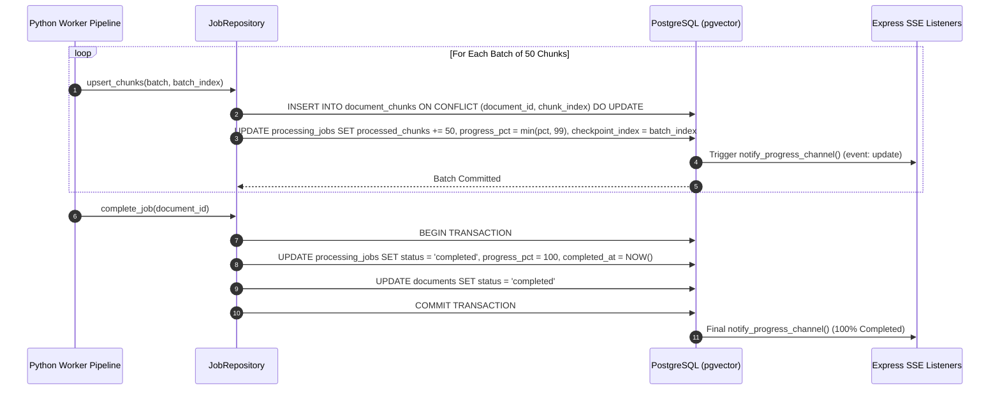

# Vector Storage & Progress Checkpointing

> High-throughput pgvector chunk ingestion, batch checkpoint progress updates, and atomic transactional completions.

---

## Storage Lifecycle

The vector storage pipeline (`app/repositories/job_repository.py`) handles persisting text chunks and 1024-dimensional embeddings into PostgreSQL while updating granular job state counters that trigger real-time UI progress frames.

---

## Idempotent Chunk Upsert Key

In distributed environments, worker pods may retry jobs following spot interruptions or timeout resets. To prevent chunk duplication:

- **Composite Unique Key**: The schema enforces `UNIQUE (document_id, chunk_index)` on the `document_chunks` table.
- **Conflict Resolution**: Writes execute using PostgreSQL `ON CONFLICT (document_id, chunk_index) DO UPDATE`, ensuring re-processing an existing batch safely overwrites vector embeddings and content without duplicating rows.
- **SQLAlchemy Vector Mapping**: The `embedding` column maps to `pgvector.sqlalchemy.Vector(1024)`, handling binary vector serialization over standard PostgreSQL connections.

---

## Batch Checkpoint Progress Updates

To avoid write amplification from updating database progress on every individual chunk (e.g. 5,000 writes for a 5,000-chunk document), the repository checkpoints progress once per **50-chunk batch**:

1. **`processed_chunks`**: Incremented by the batch size.
2. **`progress_pct`**: Calculated as `round((processed_chunks / total_chunks) * 100)` and capped at `99%` until final completion.
3. **`checkpoint_index`**: Records the index of the batch just committed (0, 1, 2...).
4. **Trigger Emission**: Each update fires the PostgreSQL `notify_progress_channel()` trigger, delivering an SSE update frame to the browser.

---

## Atomic Terminal Completion

When all chunks are persisted, the worker finalizes the document lifecycle within a **single database transaction**:

- Transitions `processing_jobs.status` to `completed`.
- Sets `progress_pct` to `100`.
- Sets `completed_at` to the current timestamp.
- Transitions parent `documents.status` to `completed`.

This atomic commit guarantees that documents and job states remain synchronized.
