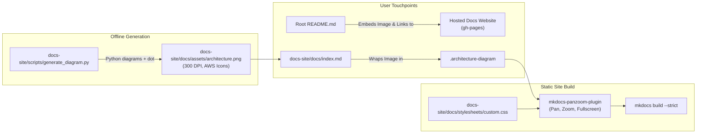

# Context Handover: AI Document Intelligence Platform — Documentation Initiative (Phase 2)

## 1. Project & Task Status Overview
- **Goal**: Implement Phase 2 of `DOCUMENTATION_PLAN.md` — Master Root `README.md` and authentic AWS/Kubernetes architecture diagram generation, alongside interactive visual integration on the static documentation site.
- **Phase 2 Status (Complete & Verified)**:
  - **Root `README.md`**: Fully authored with executive positioning for AWS DevOps Engineer Professional (AWS-DOP) and Certified Kubernetes Administrator (CKA). Covers architectural qualities, decoupled microservices topology, KEDA dual-scaling mechanics, and quickstart commands for local emulation (LocalStack / pgvector / local LLMs).
  - **Hosted Documentation Hyperlinks**: All documentation references across `README.md` resolve to the public GitHub Pages static website (`https://parth9218.github.io/Document-Intelligence-Platform/`) instead of internal repository Markdown files.
  - **High-Resolution AWS Diagram Generator**: Implemented `docs-site/scripts/generate_diagram.py` using Python `diagrams` (v0.25.1) and Graphviz, outputting a 300 DPI architecture diagram at `docs-site/docs/assets/architecture.png`.
  - **Amazon EKS v1.37 Alignment**: Pinned official AWS EKS icon in the control plane quadrant, updated version references from `1.31` to `Kubernetes 1.37` across diagrams and markdown documents.
  - **Dual KEDA Autoscaling Visualization**: Explicitly mapped KEDA triggers to both workloads: SQS queue depth scaling (0→10) for Python Worker pods, and KEDA HTTP Add-on for Express API pods.
  - **Interactive Docs-Site Integration**: Replaced raw Mermaid flowchart on `docs-site/docs/index.md` with the official AWS icon diagram, wrapped inside an interactive `.architecture-diagram` container configured with `mkdocs-panzoom-plugin` and custom CSS (`stylesheets/custom.css`) for pan, zoom, reset, and fullscreen controls.
  - **Strict Build Verification**: `mkdocs build --strict` verified with 0 errors.

---

## 2. Directory Structure & Key Artifacts

```text
/
├── DOCUMENTATION_PLAN.md                     # Authoritative 7-phase documentation blueprint
├── README.md                                 # User-facing master root README with hosted links & architecture
├── docs/
│   └── context/
│       └── docs-site/
│           ├── phase-1.md                    # Phase 1 context handover (MkDocs scaffold & nav)
│           └── phase-2.md                    # Phase 2 context handover (Root README & AWS diagram)
└── docs-site/
    ├── mkdocs.yml                            # MkDocs configuration with panzoom selector & custom CSS
    ├── scripts/
    │   └── generate_diagram.py               # Python diagrams script generating 300 DPI architecture.png
    └── docs/
        ├── index.md                          # Homepage with interactive pan/zoom architecture diagram
        ├── assets/
        │   ├── logo.png                      # Platform brand asset
        │   └── architecture.png              # 300 DPI pre-rendered AWS & Kubernetes architecture diagram
        ├── stylesheets/
        │   └── custom.css                    # Card styling & fullscreen viewport styling for panzoom
        └── architecture/                     # Destination for Step 2.2 core architecture deep dives
```

---

## 3. Key Technical Decisions & Implementation Details

### 3.1 Root `README.md` Positioning & Invariants
1. **Senior Architect & Portfolio Framing**:
   - Explicitly leads with the business problem (high-throughput document parsing and RAG) and enterprise cloud engineering patterns (AWS-DOP, CKA, GitOps).
   - Architectural qualities table captures 9 core competencies: Event-Driven Scaling, Zero Static Credentials, Gateway API, Dynamic Secret Injection, Idempotent Processing, Immutable Artifact Promotion, Direct S3 Uploads, Plugin-Based Strategy Providers, and Serialized CI/CD Governance.
   - Outlines planned roadmap items (marked with 🚧) factually without overstating completion.

2. **Decoupled Edge Routing & Session Notification Caveats**:
   - Documents the CloudFront unified ingress pattern to prevent browser HTTPS/HTTP mixed-content rejections without custom domain TLS overhead.
   - Includes senior engineering trade-off commentary regarding PostgreSQL `LISTEN/NOTIFY` channels: ideal for designed session volumes, with Redis Pub/Sub identified as the target distributed message broker for massive enterprise multi-tenancy.

### 3.2 Offline Architecture Diagram Generator (`generate_diagram.py`)
1. **Official Icon Set**:
   - Utilizes Python `diagrams` library with native AWS (`CloudFront`, `S3`, `SQS`, `EKS`, `ALB`, `RDSPostgresqlInstance`, `Bedrock`, `AutoScaling`), Kubernetes (`Pod`), and On-Premises/Tooling icons (`Argocd`, `User`).
   - Clusters are styled with distinct pastel fills and bold border strokes matching official reference diagrams.
2. **Cluster Topology & Edge Relationships**:
   - `Amazon EKS (v1.37 Managed)` visual node placed inside the Control Plane & Gateway cluster box.
   - Dual autoscaling arrows from KEDA:
     - `keda >> Edge(label="Scales (HTTP Add-on)", style="dashed", color="#ea580c") >> api_pods`
     - `keda >> Edge(label="Scales on SQS (0→10)", style="dashed", color="#ea580c") >> worker_pods`
   - S3 direct multipart upload and CloudFront `/api/*` reverse proxy pathways clearly delineated.

### 3.3 Docs Site Panzoom Integration & Custom CSS
1. **Elimination of Duplicate Visuals**:
   - Removed the raw `mermaid` flowchart block and duplicate plain image tag from `docs-site/docs/index.md`.
   - Preserved identical visual height (~680px) and 100% responsive width using `.architecture-diagram` container.
2. **PanZoom Plugin Configuration**:
   - Added `include_selectors: [".architecture-diagram"]` in `docs-site/mkdocs.yml`.
   - Set `key: "none"` to allow frictionless, modifier-free canvas panning and wheel zooming.
3. **Custom Stylesheet (`docs-site/docs/stylesheets/custom.css`)**:
   - Encapsulates `.panzoom-box` with a subtle elevation card shadow, border, and white canvas background.
   - Enforces `.panzoom-fullscreen` with `z-index: 9999 !important` and `100vw / 100vh` fixed dimensions, allowing users to inspect the 300 DPI diagram in full screen and exit via `Escape` or the minimize button.

---

## 4. Visual Workflow Architecture



---

## 5. Next Steps (Roadmap Transition to Phase 2.2)

1. **Step 2.2: Core Architecture Deep Dives**:
   - Author `docs-site/docs/architecture/overview.md` (boundaries, polyglot split rationale, C4 system context).
   - Author `docs-site/docs/architecture/data-flow.md` (sequence diagrams for upload, ingestion, retrieval, and SSE).
   - Author `docs-site/docs/architecture/technology-stack.md` (decision matrices and evaluated alternatives).
   - Author `docs-site/docs/architecture/cost-optimization.md` (monthly AWS bill breakdown and scaling curves).
2. **Phase 3: Design Decisions (ADRs) & Engineering Post-Mortems**:
   - Populate `docs-site/docs/design-decisions/` with 8 formal ADRs.
   - Populate `docs-site/docs/challenges/` with 14 engineering challenge deep dives.

---

## 6. Verification Commands

```bash
# 1. Regenerate high-resolution architecture diagram
python3 docs-site/scripts/generate_diagram.py

# 2. Strict build of documentation site
docs-site/.venv-docs/bin/mkdocs build --strict -f docs-site/mkdocs.yml

# 3. Local preview server
docs-site/.venv-docs/bin/mkdocs serve -f docs-site/mkdocs.yml
```
