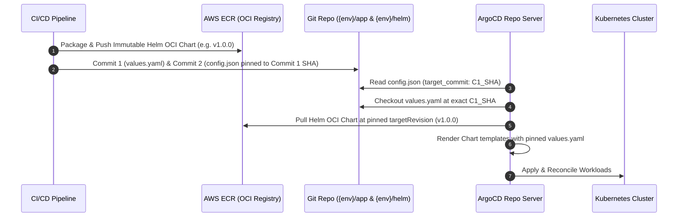

# Kubernetes Platform & GitOps (Terraform)

<p align="center">
  <strong>Declarative Terraform configurations provisioning the Kubernetes platform layer, Gateway API, ArgoCD Multi-Source GitOps, KEDA autoscaling, and External Secrets on Amazon EKS.</strong>
</p>

<p align="center">
  = 1.15" />
  
  
  
  
  
</p>

<p align="center">
  <a href="#overview">Overview</a> &bull;
  <a href="#platform-architecture">Architecture</a> &bull;
  <a href="#core-platform-components">Components</a> &bull;
  <a href="#manifests--crd-specifications">Manifests</a> &bull;
  <a href="#argocd-multi-source-gitops">GitOps Engine</a> &bull;
  <a href="#deployment-workflow">CLI Usage</a> &bull;
  <a href="#configuration-variables--outputs">Variables & Outputs</a> &bull;
  <a href="#apple-silicon--arm64-compatibility">ARM64 Note</a> &bull;
  <a href="https://parth9218.github.io/Document-Intelligence-Platform/">📖 Full Documentation</a>
</p>

---

## Overview

The `infra/terraform/k8s` directory contains Terraform configurations responsible for establishing the Kubernetes application platform layer on top of the Amazon EKS cluster provisioned in `infra/terraform/aws`. Operating on **EKS Auto Mode (v1.37)**, the cluster eliminates traditional EC2 Managed Node Groups in favor of AWS-managed `general-purpose` and `system` node pools with automated node right-sizing, OS patching, and built-in EBS CSI storage drivers.

This module provisions cluster ingress controllers, declarative GitOps deployment reconciliation engines, automated credential rotation operators, and event-driven pod autoscaling policies.

### Key Architectural Highlights

- **Kubernetes Gateway API (v1.6.1)**: Modern ingress specification replacing legacy Kubernetes Ingress. Establishes a declarative hierarchy of `GatewayClass` (`alb`), `Gateway` (`api-gateway`), and workload-scoped `HTTPRoute` resources managed natively by the AWS Load Balancer Controller with IP target routing.
- **ArgoCD Multi-Source GitOps (`ApplicationSet`)**: Continuous delivery engine reconciling application states from two distinct decoupled sources: immutable Helm OCI charts published to private AWS ECR (Source 1), and environment-specific values and image tags pinned to exact Git commit SHAs (Source 2).
- **Automated ECR Credential Rotation via ESO**: Resolves ArgoCD Helm OCI authentication limitations by deploying the **External Secrets Operator (ESO)** with EKS Pod Identity. ESO generates and refreshes 12-hour AWS ECR authorization tokens every 1 hour directly into ArgoCD repository secrets (`argocd.argoproj.io/secret-type: repository` and `repo-creds`).
- **Dual KEDA Autoscaling Mechanics**: Workload autoscaling decoupled by traffic pattern:
  - **Worker Daemon**: Scaled 0→10 pods based on Amazon SQS queue depth (`aws-sqs-queue` trigger) via native Pod Identity authentication.
  - **Express API**: Scaled dynamically based on concurrent connection saturation and request rates via the **KEDA HTTP Add-on** (`http.keda.sh/v1beta1` `InterceptorRoute`).
- **Secrets Store CSI Driver Integration**: Injects AWS Secrets Manager database credentials and SSM Parameter Store configurations into pod memory via ephemeral CSI volumes, eliminating static Kubernetes secrets from cluster etcd storage.

---

## Platform Architecture

The Kubernetes platform layer glues the underlying AWS infrastructure to running microservices through custom controllers and declarative custom resource definitions (CRDs):

<p align="center">
  
</p>

### Platform Interaction & Reconciliation Flows

1. **Gateway API Ingress Routing**: The **AWS Load Balancer Controller** reconciles Kubernetes Gateway API resources (`GatewayClass`, `Gateway`, `HTTPRoute`) into an AWS Application Load Balancer using direct IP target routing to Express API pods.
2. **ArgoCD Multi-Source GitOps**: The **ArgoCD ApplicationSet** matrix generator reconciles two decoupled sources: immutable Helm OCI packages from private AWS ECR (Source 1: `{{chart_name}}:{{chart_version}}`) and environment values pinned to exact Git commit SHAs (Source 2: `values.yaml` at `{{target_commit}}`).
3. **Automated Credential Rotation**: The **External Secrets Operator (ESO)** assumes an EKS Pod Identity IAM role to generate 12-hour AWS ECR authorization tokens, refreshing them hourly into ArgoCD repository secrets (`argocd.argoproj.io/secret-type: repository` and `repo-creds`).
4. **Secrets Store CSI Driver Injection**: Ephemeral CSI volumes fetch database credentials and SSM parameters from AWS Secrets Manager directly into pod memory via `SecretProviderClass`, avoiding static Kubernetes secret storage.
5. **Decoupled Dual KEDA Autoscaling**: The **KEDA HTTP Add-on** scales Express API pods based on incoming HTTP request rates and connection concurrency, while **KEDA Core** scales Ingestion Worker pods 0→10 based on Amazon SQS queue depth.

---

## Core Platform Components

This Terraform configuration deploys and manages the following platform controllers:

| Component                        | Management Mode           | Version   | Architectural Responsibility                                                                                                                                                                               |
| :------------------------------- | :------------------------ | :-------- | :--------------------------------------------------------------------------------------------------------------------------------------------------------------------------------------------------------- |
| **AWS Load Balancer Controller** | Helm (`kube-system`)      | `v3.5.0`  | Reconciles Gateway API resources into AWS Application Load Balancers. Configured with `enableGatewayAPI = true`, `defaultTargetType = ip`, and bound to the controller's EKS Pod Identity service account. |
| **Gateway API CRDs**             | Kubectl Manifests         | `v1.6.1`  | Installs the standard Kubernetes Gateway API custom resource definitions (`GatewayClass`, `Gateway`, `HTTPRoute`, `ReferenceGrant`).                                                                       |
| **ArgoCD**                       | Helm (`argocd`)           | `v10.3.0` | Deploys ArgoCD server, application controller, and repo server. Reconciles application state without manual `kubectl` interventions.                                                                       |
| **External Secrets Operator**    | Helm (`external-secrets`) | `v2.12.0` | Automates external secret synchronization. Leverages an assigned EKS Pod Identity IAM role to generate AWS ECR authorization tokens.                                                                       |
| **KEDA Core**                    | Helm (`keda`)             | `v2.20.2` | Kubernetes Event-driven Autoscaling engine. Installs core ScaledObject CRDs and polls external metrics providers (e.g. Amazon SQS).                                                                        |
| **KEDA HTTP Add-on**             | Helm (`keda`)             | `v0.15.0` | Intercepts HTTP traffic and scales the Express API deployment based on live incoming request volume and connection concurrency.                                                                            |

---

## Manifests & CRD Specifications

Custom platform manifests are stored in `manifests/` and templated during Terraform execution:

- **`alb_gatewayclass.yaml`**: Declares the `GatewayClass` named `alb` referencing `controllerName: eks.amazonaws.com/alb`.
- **`api_gateway.yaml`**: Provisions the public Gateway listening on port 80/443 with TLS termination backed by the ACM certificate ARN provisioned in the AWS layer.
- **`argocd-applicationset.yaml`**: Multi-Source matrix generator that discovers application configurations across `infra/k8s/argocd/${environment}/${app}/` and binds the OCI chart source with the Git values source.
- **`argocd-ecr-secret.yaml`**: Declares an `ECRAuthorizationToken` generator (`ecr-helm-token`) and `ExternalSecret` templates that generate `argocd.argoproj.io/secret-type: repository` and `repo-creds` secrets refreshed every 1 hour.
- **`secrets-provider-class.yaml`**: Declares the `SecretProviderClass` referencing AWS SSM parameters and Secrets Manager secrets for in-pod volume mounting.

---

## ArgoCD Multi-Source GitOps

To achieve strict immutable artifact promotion without git merge drift, the platform decouples the Helm chart structure from the application values:



### ArgoCD Commit Pinning Invariant

Moving branch references (e.g., `HEAD` of `dev` or `main`) introduce silent deployment drift. In staging and production, the ApplicationSet configures:

- `Source 1 (ECR OCI)`: Pinned to the exact immutable semver tag (`{{chart_version}}`).
- `Source 2 (Git Values)`: Pinned to the exact Git commit SHA (`{{target_commit}}`) recorded in `infra/k8s/argocd/${env}/${app}/config.json`.

Release branches (`{env}/app` and `{env}/helm`) are protected branches updated strictly via serialized CI/CD pipeline commits.

---

## Deployment Workflow

### Prerequisites

- [Terraform CLI](https://developer.hashicorp.com/terraform/downloads) (`>= 1.15.0`)
- [Kubectl CLI](https://kubernetes.io/docs/tasks/tools/) matching EKS version 1.37
- Provisioned AWS Infrastructure layer (`infra/terraform/aws`) providing VPC, EKS cluster, and ACM outputs

### Step-by-Step CLI Execution

```bash
# 1. Navigate to the K8s Terraform workspace
cd infra/terraform/k8s

# 2. Initialize Terraform with environment-specific remote backend coordinates
terraform init -backend-config=environments/dev/backend.config.hcl

# 3. Generate execution plan referencing target environment variables
terraform plan -var-file=environments/dev/dev.tfvars -out=tfplan

# 4. Apply platform resources to the EKS cluster
terraform apply tfplan

# 5. Retrieve provisioned ALB DNS and connect to the cluster
terraform output api_alb_dns
$(terraform output -raw eks_update-kubeconfig-cmd)
```

---

## Configuration Variables & Outputs

### Key Input Variables (`variables.tf`)

| Variable                | Type     | Default      | Description                                                                  |
| :---------------------- | :------- | :----------- | :--------------------------------------------------------------------------- |
| `cluster_name`          | `string` | _(Required)_ | Name of the Amazon EKS cluster provisioned in the AWS layer                  |
| `vpc_id`                | `string` | _(Required)_ | Identifier of the VPC where the cluster resides                              |
| `project_name`          | `string` | _(Required)_ | Project prefix (`docintel`)                                                  |
| `environment`           | `string` | _(Required)_ | Target deployment environment (`dev`, `stg`, `prod`)                         |
| `api_domain`            | `string` | _(Required)_ | Custom domain name configured on the Gateway API listener                    |
| `acm_cert_arn`          | `string` | _(Required)_ | ARN of the TLS certificate provisioned by ACM                                |
| `ssm_parameters_name`   | `string` | _(Required)_ | Name of the SSM Parameter Store entry                                        |
| `ssm_secrets_name`      | `string` | _(Required)_ | Name of the Secrets Manager database secret entry                            |
| `github_repository_url` | `string` | _(Required)_ | HTTPS URL of the Git repository tracking GitOps values                       |
| `targetRevision_app`    | `string` | `"dev"`      | Git revision/branch tracking application values (e.g. `dev` or `{env}/app`)  |
| `targetRevision_helm`   | `string` | `"dev"`      | Git revision/branch tracking Helm chart configs (e.g. `dev` or `{env}/helm`) |
| `ecr_registry_url`      | `string` | `""`         | Base ECR registry domain (defaults to current account and region)            |

### Key Outputs (`outputs.tf`)

| Output Name                         | Description                                                                              |
| :---------------------------------- | :--------------------------------------------------------------------------------------- |
| `api_alb_dns`                       | Dynamic DNS hostname of the AWS Application Load Balancer provisioned by the Gateway API |
| `eks_update-kubeconfig-cmd`         | Ready-to-execute AWS CLI command to authenticate `kubectl` against the EKS cluster       |
| `argocd_port-forward-cmd`           | Command to forward local port 8080 to the `argocd-server` service                        |
| `argocd_initial_admin_password_cmd` | Command to decode the initial bootstrap administrator password for ArgoCD                |

---

## Apple Silicon & ARM64 Compatibility

> [!WARNING]
> **Provider Lock File Checksum Invariant**:
> If running Terraform from an Apple Silicon (ARM64) workstation, ensure Linux AMD64 provider hashes are locked into `.terraform.lock.hcl` so CI/CD pipelines hit cached provider mirrors:
>
> ```bash
> terraform providers lock -platform=linux_amd64 -platform=darwin_arm64
> ```

---

## Related Documentation

- [Kubernetes Platform Architecture Specification](https://parth9218.github.io/Document-Intelligence-Platform/infrastructure/kubernetes/overview/)
- [ArgoCD Multi-Source GitOps Specification](https://parth9218.github.io/Document-Intelligence-Platform/infrastructure/kubernetes/argocd-gitops/)
- [AWS Cloud Infrastructure README](../aws/README.md)
- [Remote State Query Module README](../query/README.md)
