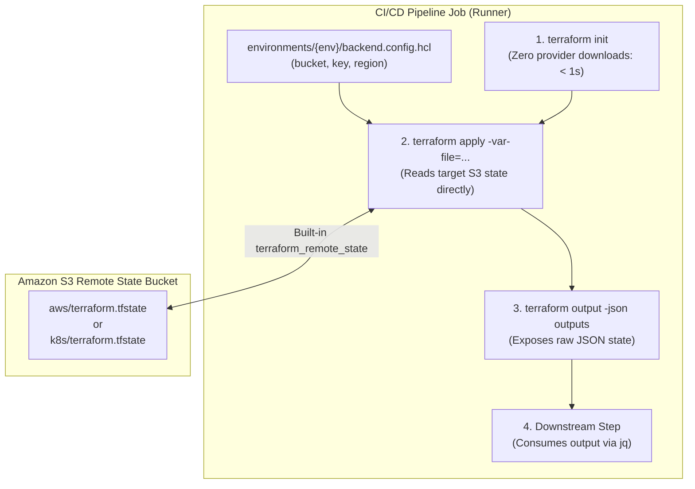

# Terraform Remote State Query Module

<p align="center">
  <strong>Zero-provider Terraform utility module designed for instantaneous, lightweight remote state inspection in automated CI/CD pipelines.</strong>
</p>

<p align="center">
  = 1.0" />
  
  
  
</p>

<p align="center">
  <a href="#overview--problem-statement">Overview</a> &bull;
  <a href="#architectural-mechanics">Mechanics</a> &bull;
  <a href="#cli-usage">CLI Usage</a> &bull;
  <a href="#cicd-workflow-integration">CI/CD Examples</a> &bull;
  <a href="#variables--outputs">Variables & Outputs</a> &bull;
  <a href="https://parth9218.github.io/Document-Intelligence-Platform/challenges/terraform-query-module/">📖 Full Post-Mortem</a>
</p>

---

## Overview & Problem Statement

In decoupled, multi-concern continuous deployment architectures, downstream deployment pipelines (such as microservice container builds, Helm chart packaging, and static asset distribution) routinely require dynamic outputs produced by prior infrastructure layers:

- **API & Worker CI/CD**: Requires the private ECR repository URLs (`ecr_repo_urls`) and registry domain (`ecr_registry_url`).
- **Helm Chart CI/CD**: Requires target and lower-environment ECR repositories for cross-environment OCI chart promotion.
- **Frontend CI/CD**: Requires the target frontend S3 bucket name (`frontend_bucket_id`) and CloudFront distribution ID (`cloudfront_distribution_id`).
- **AWS Deployment**: Requires the live Application Load Balancer DNS (`api_alb_dns`) provisioned by the Kubernetes layer.

### The Problem with Traditional State Access

Traditionally, reading Terraform outputs in CI requires initializing the corresponding root infrastructure module (`infra/terraform/aws` or `infra/terraform/k8s`). However, running `terraform init` in those root modules forces Terraform to download multiple large provider binaries from the public registry (`hashicorp/aws`, `hashicorp/helm`, `gavinbunney/kubectl`, `hashicorp/tls`).

This introduces **60 to 90 seconds of network latency and compute overhead per workflow job**, inflating build times, consuming GitHub Actions runner minutes, and risking transient network timeouts during provider downloads.

### The Solution: Zero-Provider Remote State Query

The `infra/terraform/query` module eliminates external provider downloads entirely. It is a minimalist, standalone Terraform module with **zero external provider dependencies**, relying solely on Terraform's built-in `terraform_remote_state` data source.

By initializing locally with no provider plugins, the module reads target environment state files directly from S3 and exposes all outputs as JSON in **under 3 seconds**.

---

## Architectural Mechanics

The query module functions as a zero-footprint state reader:



### The `-var-file` Harmony Pattern

In `infra/terraform/query/variables.tf`, the input variables are defined as:

```hcl
variable "bucket" { type = string }
variable "key"    { type = string }
variable "region" { type = string }
```

These variable names match the exact key-value attributes stored in the environment-specific backend configuration files (`infra/terraform/aws/environments/{env}/backend.config.hcl` and `infra/terraform/k8s/environments/{env}/backend.config.hcl`):

```hcl
bucket = "tf-state-doc-intel-dev-793140949744-us-east-1-an"
key    = "aws/terraform.tfstate"
region = "us-east-1"
```

Because the HCL attributes match 1:1, the CI/CD pipeline can pass `backend.config.hcl` directly as a `-var-file` input to the query module without generating temporary parameter files or manual string interpolation.

---

## CLI Usage

### Step-by-Step Execution

```bash
# 1. Navigate to the query module directory
cd infra/terraform/query

# 2. Initialize with NO backend configuration (runs purely in-memory/locally)
terraform init

# 3. Query the target environment state (e.g. AWS Dev infrastructure)
terraform plan -var-file=../aws/environments/dev/backend.config.hcl -out=tfplan
terraform apply -auto-approve tfplan

# 4. Extract outputs as formatted JSON
terraform output -json outputs

# 5. Extract a specific output using jq
terraform output -json outputs | jq -r '.ecr_registry_url.value'
```

To query the Kubernetes layer state instead, simply swap the `-var-file` path:

```bash
terraform plan -var-file=../k8s/environments/dev/backend.config.hcl -out=tfplan
terraform apply -auto-approve tfplan
terraform output -json outputs | jq -r '.api_alb_dns.value'
```

---

## CI/CD Workflow Integration

Here is a representative pattern demonstrating how GitHub Actions workflows (`.github/workflows/api-worker-cicd.yml`) leverage the query module:

```yaml
- name: Query AWS Infrastructure State
  id: tf-query
  working-directory: infra/terraform/query
  run: |
    # Initialize without providers (< 1 second)
    terraform init

    # Apply remote state read using environment backend config
    terraform plan -var-file="../aws/environments/${{ env.ENV }}/backend.config.hcl" -out=tfplan
    terraform apply -auto-approve tfplan

    # Extract required output attributes
    ECR_URL=$(terraform output -json outputs | jq -r '.ecr_registry_url.value')
    echo "ecr_registry_url=${ECR_URL}" >> "$GITHUB_OUTPUT"
```

---

## Variables & Outputs

### Input Variables (`variables.tf`)

| Variable | Type | Description |
| :--- | :--- | :--- |
| `bucket` | `string` | S3 bucket name containing the target remote state file |
| `key` | `string` | S3 object key path of the remote state file (e.g. `aws/terraform.tfstate`) |
| `region` | `string` | AWS region where the remote state S3 bucket is located |

### Module Outputs (`main.tf`)

| Output Name | Type | Description |
| :--- | :--- | :--- |
| `outputs` | `any` | Dynamic map containing all exported outputs from the queried remote state |

---

## Related Documentation

- [Engineering Challenge: Terraform Query Module Optimization](https://parth9218.github.io/Document-Intelligence-Platform/challenges/terraform-query-module/)
- [AWS Cloud Infrastructure README](../aws/README.md)
- [Kubernetes Platform Infrastructure README](../k8s/README.md)
- [Deployment CI/CD Architecture Specification](https://parth9218.github.io/Document-Intelligence-Platform/deployment/overview/)
